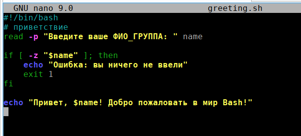
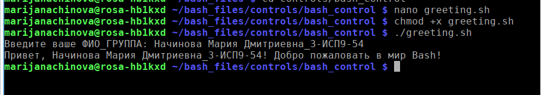
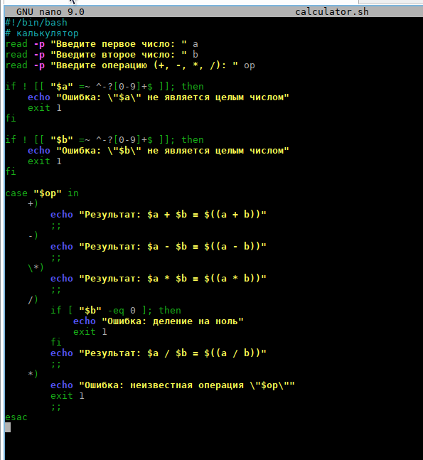
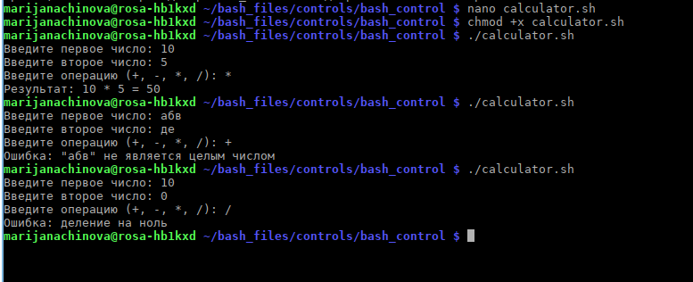
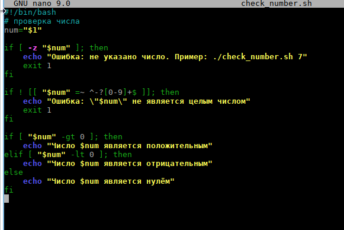
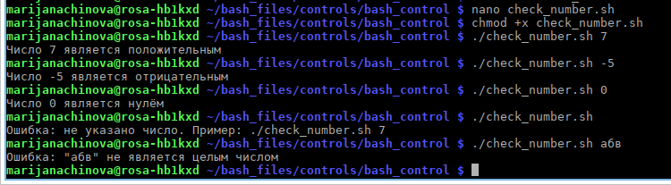
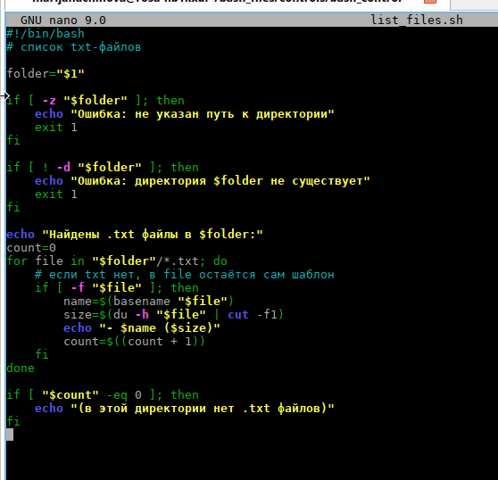
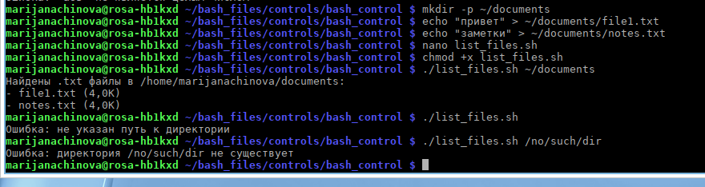

# Проверочная работа по bash

## Приветствие, калькулятор, проверка числа и список txt-файлов

МДК 02.01 · Технология и инструментальные средства разработки ПО

**Выполнила:** ст. гр. 3-ИСП9-54 Начинова М. Д.  
**Проверила:** преподаватель Кондыбаева А. Б.

*Москва, 2026*

---

**Цель.** Написать четыре bash-скрипта: приветствие, калькулятор целых чисел, проверка числа и список txt-файлов.

## Ход выполнения

### Задание 1: приветствие

Скрипт спрашивает ФИО и печатает приветствие. Если ничего не введено, сообщает об ошибке.

*Код*

*Запуск*

### Задание 2: калькулятор

Скрипт читает два целых числа и операцию +, -, * или /. Деление на ноль и нецелое число обрабатываются отдельно.

*Код*

*Запуск*

### Задание 3: проверка числа

Число передаётся первым аргументом. Скрипт пишет, положительное оно, отрицательное или ноль.

*Код*

*Запуск*

### Задание 4: список файлов

Путь к папке передаётся первым аргументом. Если папка есть, скрипт печатает txt-файлы и их размер. Если папки нет, печатает ошибку.

*Код*

*Запуск*

---

## Вывод

Написаны четыре bash-скрипта: приветствие, калькулятор, проверка числа и список txt-файлов. У каждого скрипта есть комментарии, проверка ошибок и проверка запуска в Linux.
