# Практическая работа №1

## Основы Bash-скриптинга в ОС Ubuntu

МДК 02.01 · Технология и инструментальные средства разработки ПО

**Выполнила:** ст. гр. 3-ИСП9-54 Начинова М. Д.  
**Проверила:** преподаватель Кондыбаева А. Б.

*Москва, 2026*

---

**Цель.** Изучить создание и запуск Bash-скриптов в операционной системе Ubuntu, освоить переменные, ввод данных, условные операторы, циклы, функции, обработку ошибок, отладку и применение полезных команд.

## Ход выполнения

### 2. Создание первого скрипта

*Создание файла*

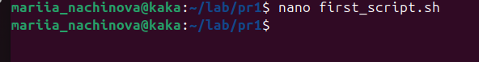

*Добавление «шебанга»*

*Простой скрипт*

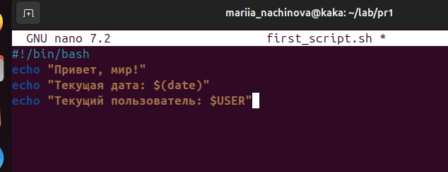

*Даем права на выполнение*

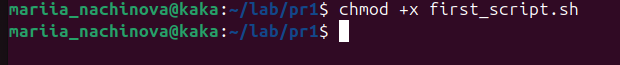

*Запуск скрипта*

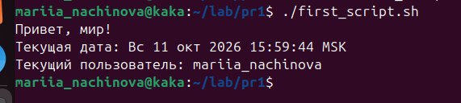

### 3. Основы синтаксиса

*Переменные*

*Объявление переменных*

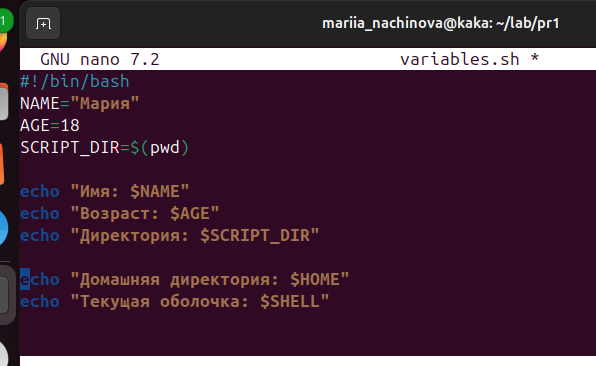

*Использование переменных*

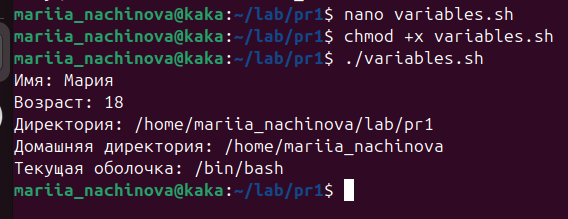

*Ввод данных*

*Ввод данных*

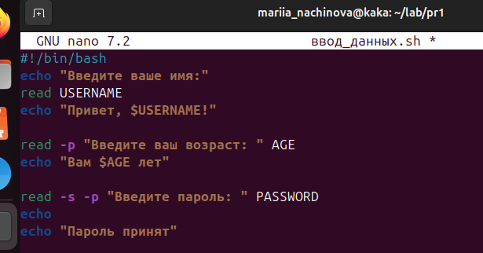

*Запуск скрипта*

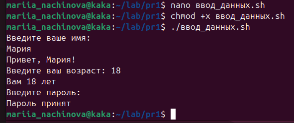

### 4. Условные операторы

*Базовый синтаксис if*

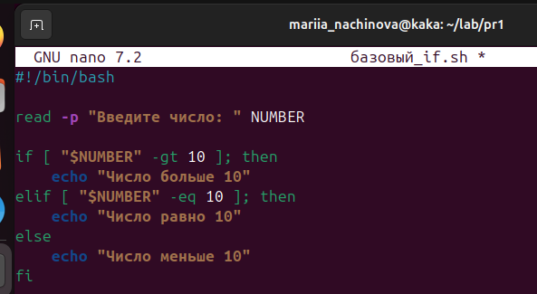

*Запуск скрипта*

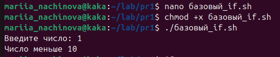

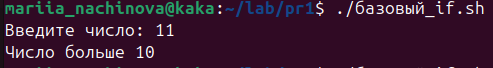

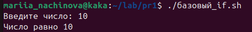

*Пример проверки файла*

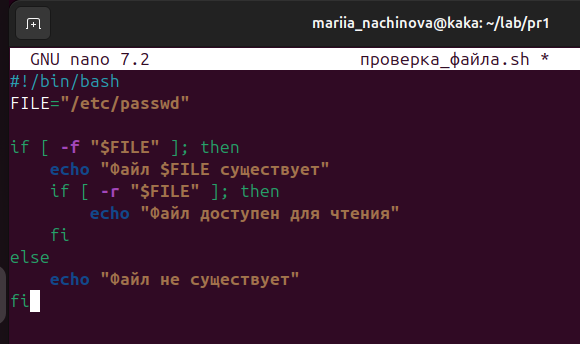

*Запуск скрипта*

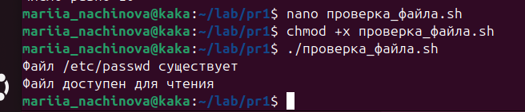

### 5. Циклы

*Цикл for*

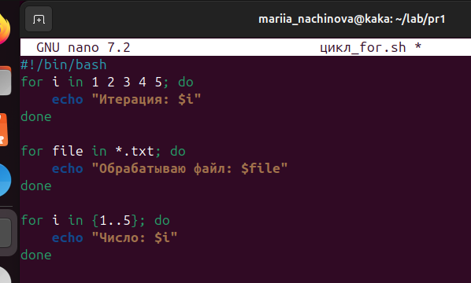

*Запуск скрипта*

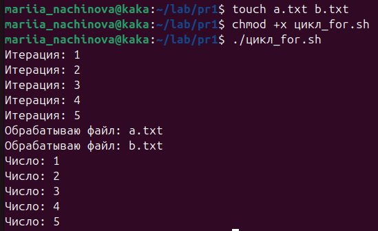

> Перед запуском созданы файлы a.txt и b.txt, иначе циклу по *.txt нечего обрабатывать.

*Цикл while*

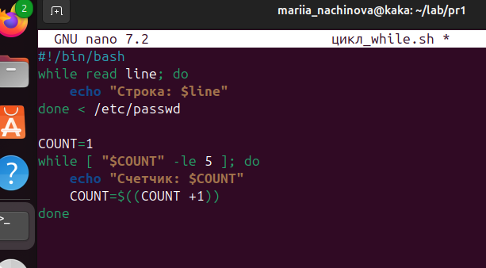

*Запуск скрипта*

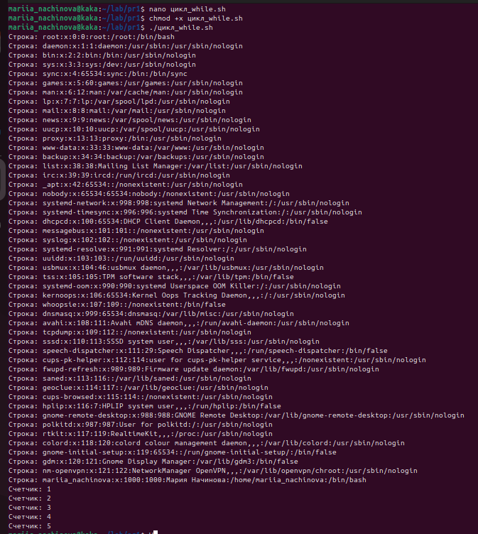

> Вместо ((COUNT++)) записала COUNT=$((COUNT + 1)). У ((COUNT++)) код возврата равен старому значению, и при нуле скрипт с set -e останавливается.

### 6. Функции

*Создание и использование функций*

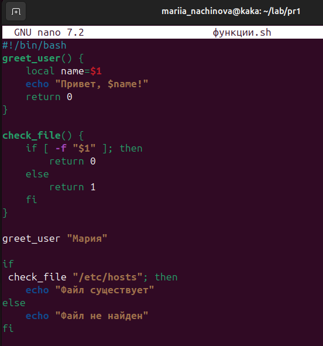

*Запуск скрипта*

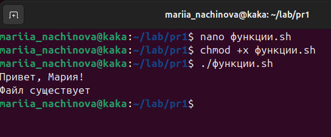

### 7. Полезные примеры

*Сканер сети*

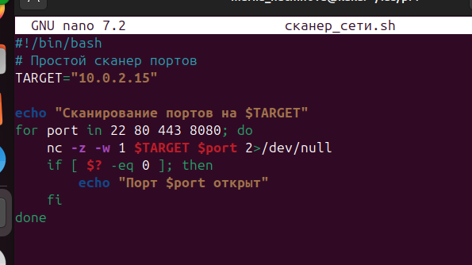

*Запуск скрипта*

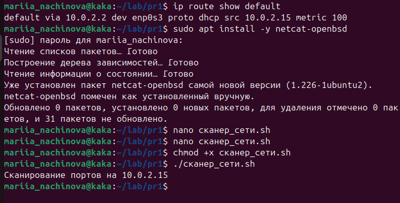

> Вместо 192.168.1.1 указала адрес своей виртуальной машины 10.0.2.15. Порты 22, 80, 443 и 8080 закрыты, поэтому скрипт вывел только строку сканирования

*Мониторинг системы*

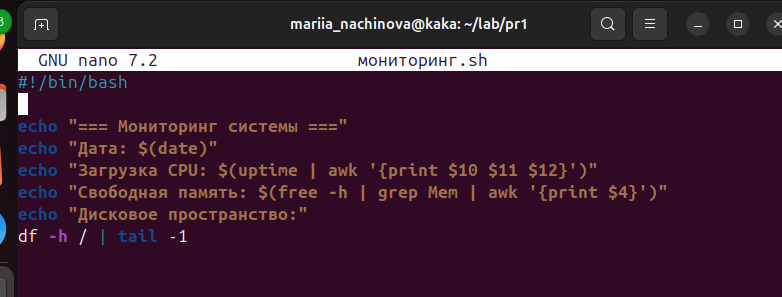

*Запуск скрипта*

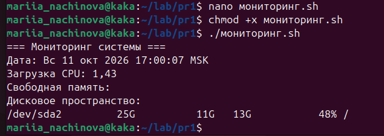

*Резервное копирование*

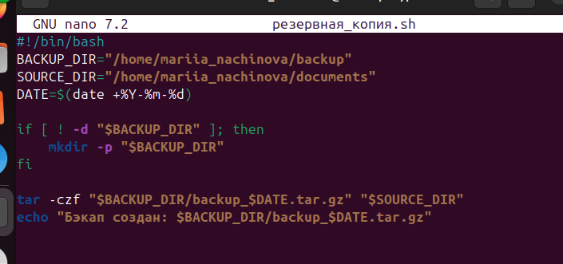

*Запуск скрипта*

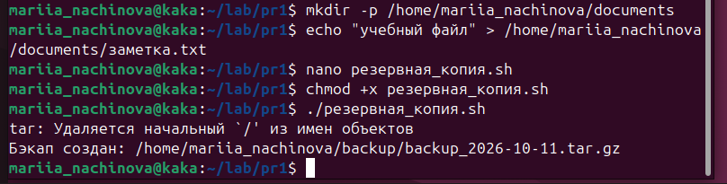

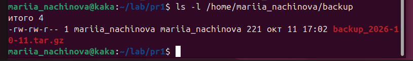

*Автоматизация обновлений*

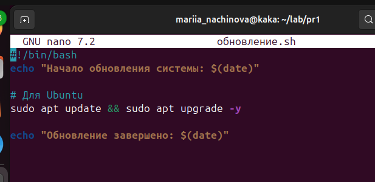

*Запуск скрипта*

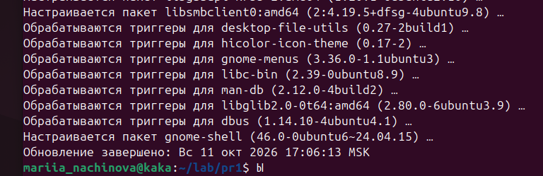

### 8. Обработка ошибок

*Базовая обработка ошибок*

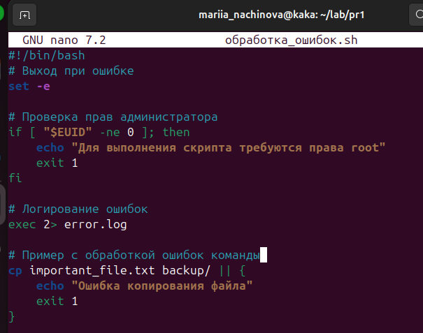

*Запуск скрипта*

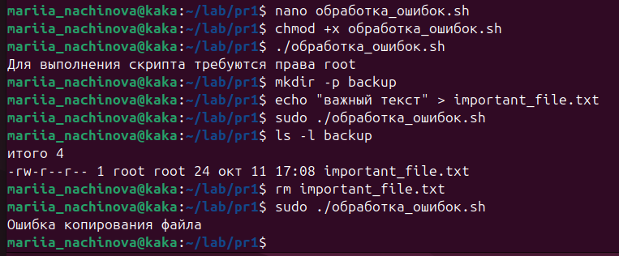

### 9. Отладка скриптов

*Методы отладки*

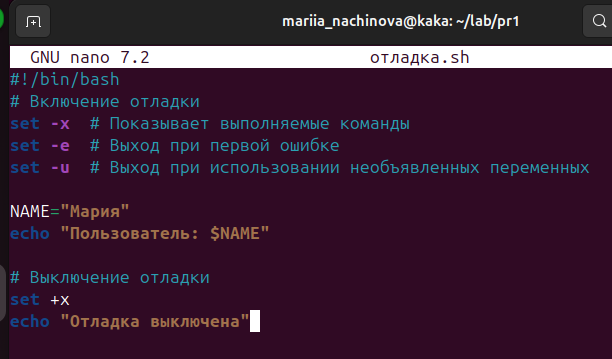

*Запуск с отладкой*

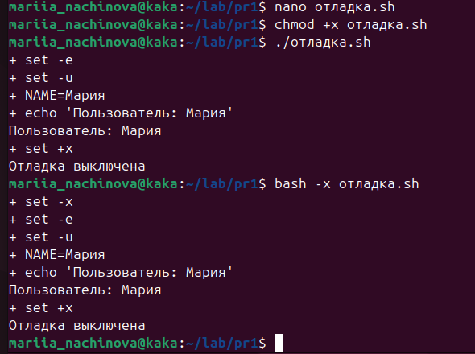

### 10. Правильно оформленный скрипт

*Пример хорошо оформленного скрипта*

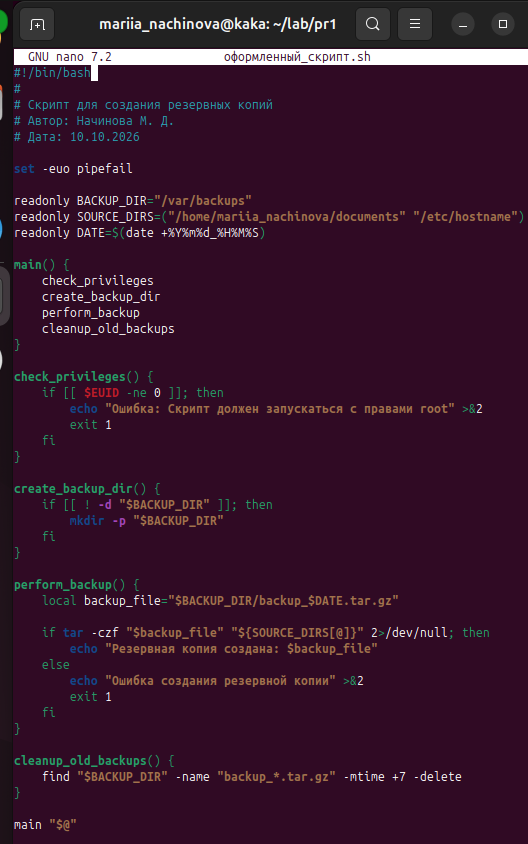

*Запуск скрипта*

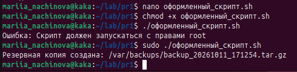

> В архив взяла каталог documents и файл /etc/hostname, а не /home и /etc целиком, чтобы архив не занимал всю систему.

### 11. Полезные команды

*Использование полезных команд*

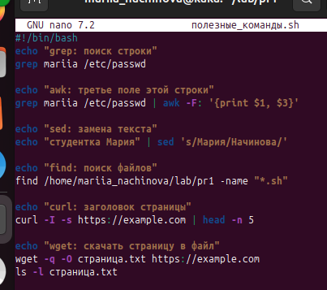

*Запуск скрипта*

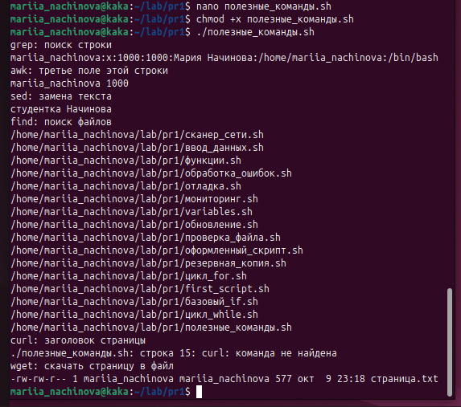

---

## Вывод

В ходе практической работы изучены основы Bash-скриптинга в Ubuntu. Созданы и запущены скрипты с переменными, вводом данных, условиями, циклами и функциями. Выполнены примеры сканирования портов, мониторинга, резервного копирования, обновления системы, обработки ошибок и отладки.
