# Практическая работа

## Основы работы с Linux

МДК 02.01 · Технология и инструментальные средства разработки ПО

**Выполнила:** ст. гр. 3-ИСП9-54 Начинова М. Д.  
**Проверила:** преподаватель Кондыбаева А. Б.

*Москва, 2026*

---

**Цель.** Научиться работать с основными командами Linux: файлы и каталоги, поиск и фильтрация, права доступа, сеть, написание простого скрипта.

## Ход выполнения

### 1. Часть 1.1. Навигация и создание структуры

#### Шаг 1. Где я нахожусь (pwd)

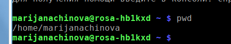

> Результат: /home/marijanachinova

#### Шаг 2. Содержимое домашней папки (ls ~)

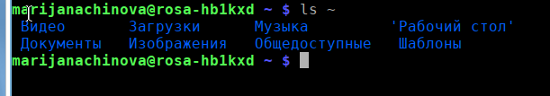

> Результат: Видео, Документы, Загрузки, Изображения, Музыка, Общедоступные, Рабочий стол, Шаблоны

*Шаги 3-5. Создание папки linux_practice и переход в неё*

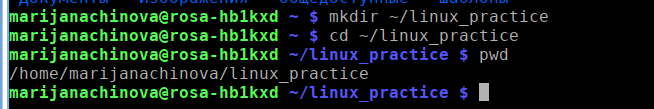

> Результат: /home/marijanachinova/linux_practice

*Шаги 6-7. Вложенные папки*

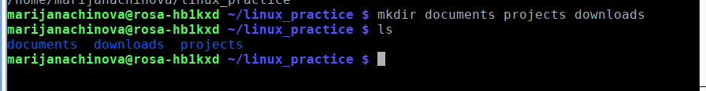

> Результат: documents  downloads  projects

**Что означает тильда ~ в команде ls ~?**

~ - сокращённая запись домашней папки текущего пользователя (например, /home/имя), поэтому ls ~ показывает содержимое домашней папки.

### 2. Часть 1.2. Создание и работа с файлами

*Шаги 1-4. Создание readme.txt, дописывание строки с датой и содержимое файла*

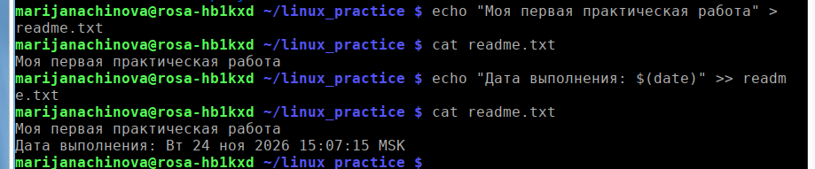

> Результат: в файле две строки: «Моя первая практическая работа» и «Дата выполнения: Вт 24 ноя 2026 15:07:15 MSK»

*Шаги 5-6. Файл numbers.txt с числами*

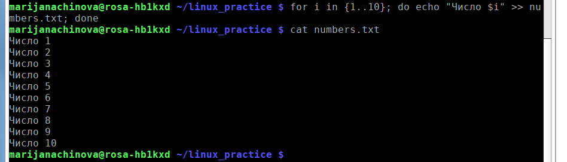

**В чём разница между > и >>?**

`>` перезаписывает файл (старое содержимое пропадает), а >> дописывает новые данные в конец файла.

### 3. Часть 1.3. Копирование и перемещение

*Шаги 1-2. Копирование readme.txt в documents*

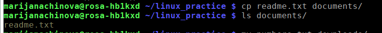

*Шаги 3-4. Перемещение numbers.txt в downloads*

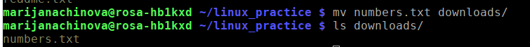

*Шаги 5-6. Копирование папки documents в projects*

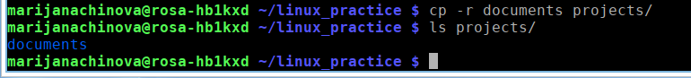

**Зачем нужна опция -r в команде cp?**

-r значит «рекурсивно»: она копирует папку вместе со всем её содержимым. Без неё cp не копирует каталог и выдаёт ошибку.

### 4. Часть 2.1. Поиск файлов

*Шаги 1-2. Файлы разных расширений и поиск .txt*

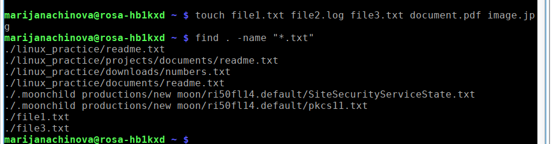

> Результат: найдено 8 файлов: readme.txt (в linux_practice, documents и projects/documents), numbers.txt, file1.txt, file3.txt и два служебных .txt в .moonchild productions

*Шаги 3-5. Поиск по имени, размеру и времени изменения*

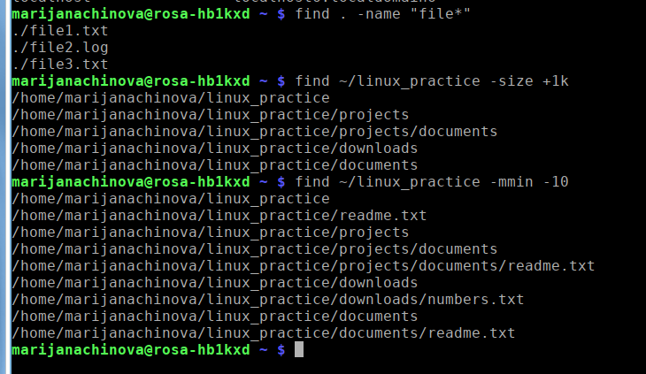

### 5. Часть 2.2. Поиск текста (grep)

*Шаги 1-5. Файл data.txt и поиск в нём (grep)*

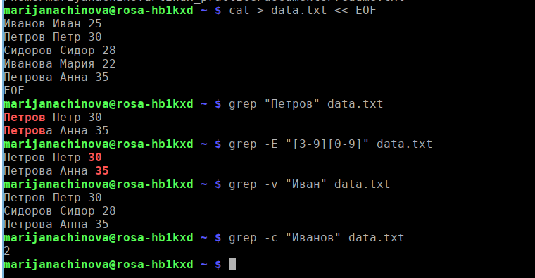

> Результат: 2

**Что делает опция -v в grep?**

Инвертирует поиск: показывает только те строки, в которых шаблона нет.

### 6. Часть 2.3. Конвейеры

*Шаги 1-6. head, tail, sort, awk, uniq*

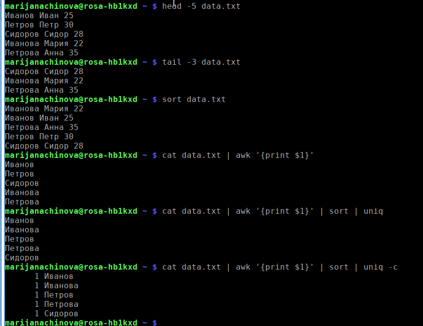

**Как работает символ | (pipe) в Linux?**

Передаёт вывод одной команды на вход следующей, так можно строить цепочки из нескольких команд.

### 7. Часть 3.1. Права доступа

*Шаги 1-2. Создание script.sh и его права*

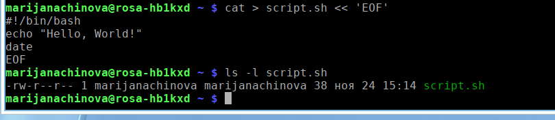

> Результат: -rw-r--r--

*Шаги 3-4. Права после chmod +x*

> Результат: -rwxr-xr-x

*Шаги 5-7. Запуск скрипта и попытка чтения после chmod -r*

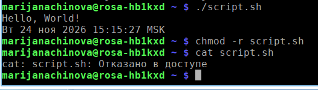

#### Шаг 8. Возврат прав (chmod 644)

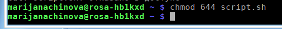

**Что произошло, когда файл попытались прочитать после chmod -r?**

Команда cat выдала ошибку «Отказано в доступе» (Permission denied): у владельца убрали право на чтение.

**Что означают цифры 644 в chmod 644?**

Это права в виде числа: 6 (чтение и запись) у владельца, 4 (только чтение) у группы и 4 (только чтение) у остальных, то есть rw-r--r--.

### 8. Часть 4.1. Проверка соединения

#### Шаг 1. Проверка соединения с 0.0.0.0

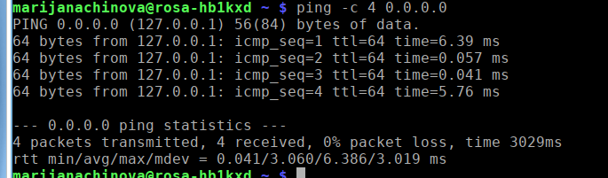

> Результат: среднее время ответа 3,06 мс (rtt avg = 3.060 ms), потерь пакетов 0%

#### Шаг 2. Проверка соединения с ya.ru

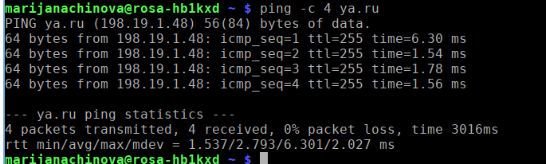

*Шаги 3-5. IP-адрес, сетевые соединения и внешний IP*

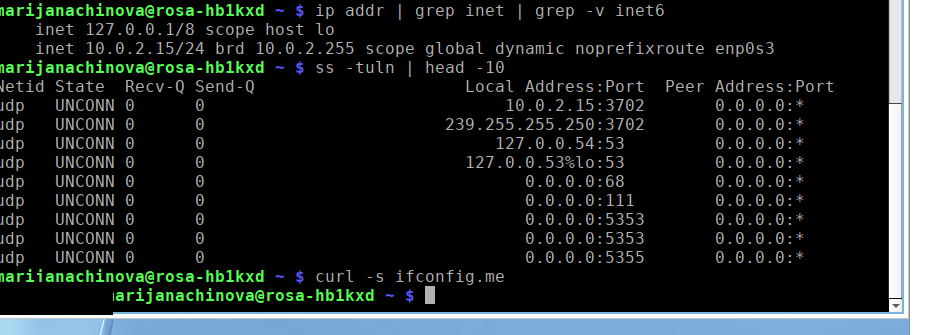

> Результат: 95.24.х.х (последние цифры скрыла)

### 9. Часть 4.2. DNS и загрузка

*Шаги 1-5. nslookup, dig, скачивание страницы и заголовки*

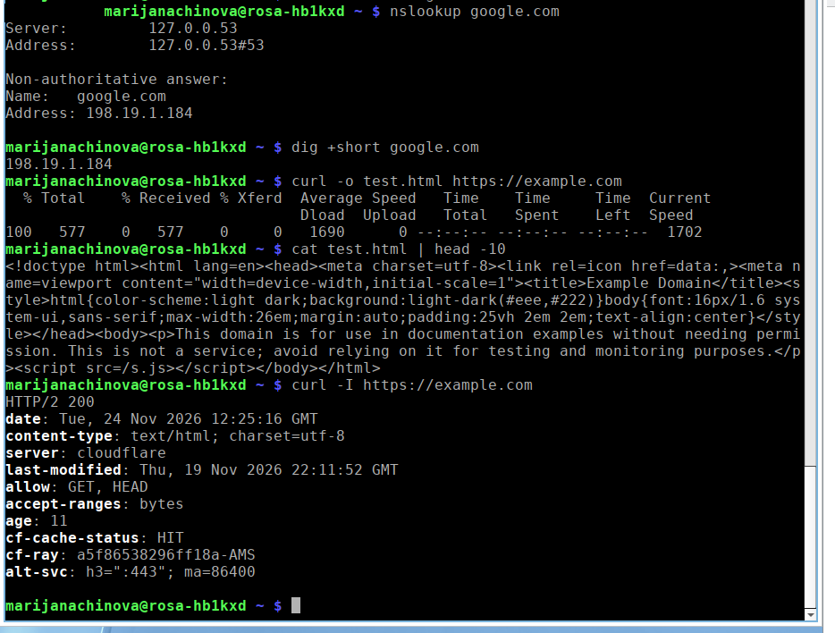

**Что показывает команда curl -I?**

Только заголовки ответа сервера (код ответа, тип содержимого, дата и т.д.), без самого содержимого страницы.

### 10. Часть 5. Скрипт myfirstscript.sh

*Код скрипта myfirstscript.sh*

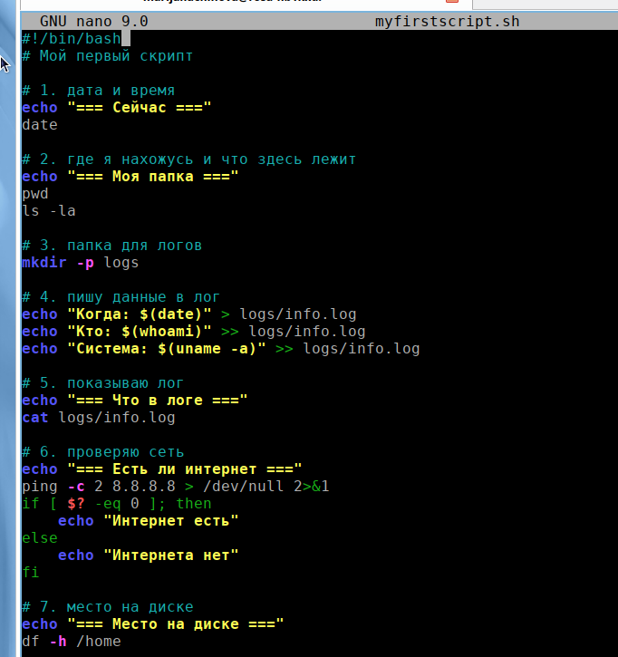

*Запуск myfirstscript.sh*

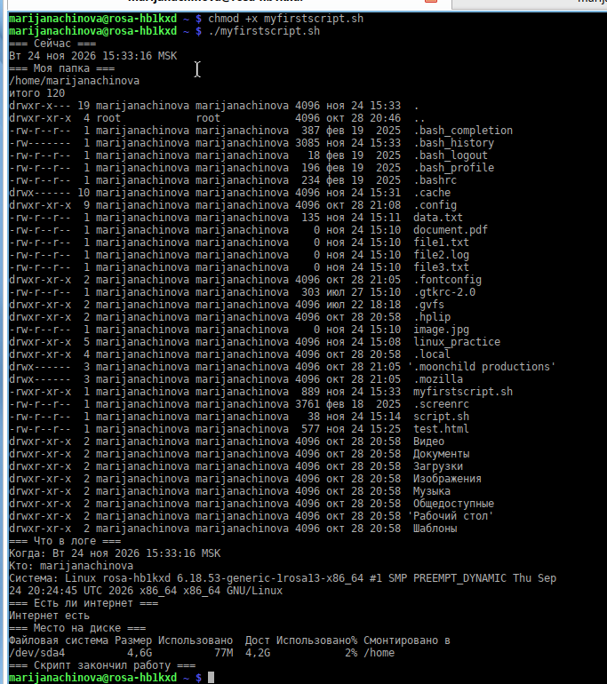

### 11. Дополнительное задание 1 (структура папок)

*Создание структуры папок: команды и результат*

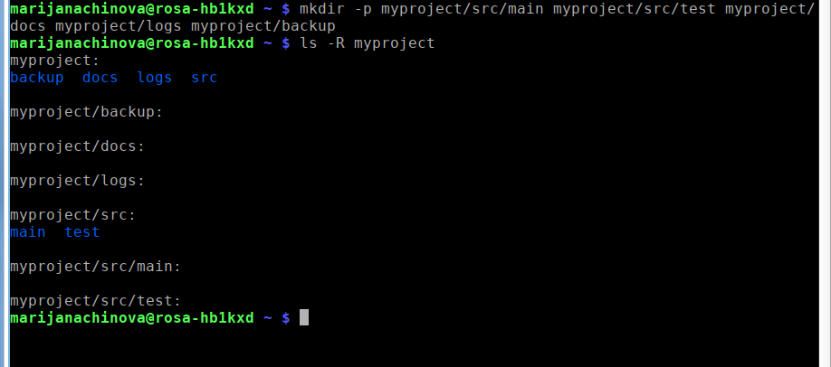

### 12. Дополнительное задание 2 (поиск .log)

*Поиск 5 самых больших .log-файлов: команда и результат*

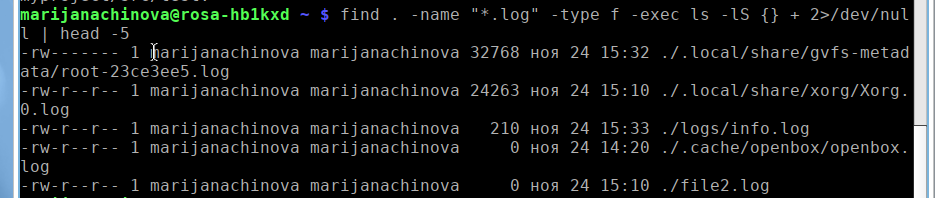

### 13. Дополнительное задание 3 (system_info.sh)

*Сведения о системе: команды и результат*

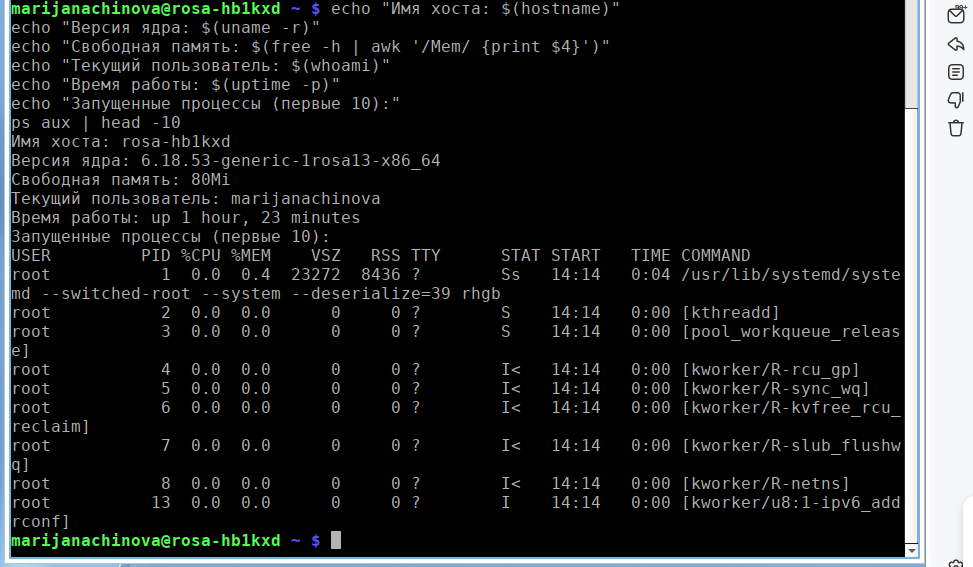

---

## Контрольные вопросы

### 1. Какая команда показывает содержимое текущей директории?

ls (с -la подробнее).

### 2. Как создать новую директорию?

mkdir имя.

### 3. Как скопировать файл с сохранением прав?

cp -p файл копия (или cp -a).

### 4. Чем отличается > от >>?

`>` перезаписывает файл, >> дописывает в конец.

### 5. Как найти все файлы с расширением .txt?

find . -name "*.txt".

### 6. Как сделать файл исполняемым?

chmod +x файл.

### 7. Как посмотреть IP-адрес компьютера?

ip addr (или ip a).

### 8. Что делает команда grep?

grep ищет строки по шаблону в тексте/файле.

---

## Вывод

Я выполнила все части практической работы и дополнительные задания, освоила основные команды Linux, права доступа, поиск и работу с сетью и написала скрипты на bash.
