# Практическая работа

## Вычислительные операции в bash

МДК 02.01 · Технология и инструментальные средства разработки ПО

**Выполнила:** ст. гр. 3-ИСП9-54 Начинова М. Д.  
**Проверила:** преподаватель Кондыбаева А. Б.

*Москва, 2026*

---

**Цель.** Научиться выполнять вычисления в bash: использовать арифметическое расширение, переменные, ввод чисел, case, циклы и bc, освоить редактор nano.

## Ход выполнения

### Часть 0. Работа с редактором nano

### Задание 0. Создание test_nano.txt

*Три строки, набранные в nano*

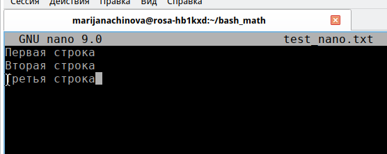

*Файл открыт повторно: текст на месте*

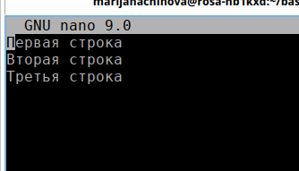

### Часть 1. Как создать и запустить скрипт

*Шаги 3-6. Скрипт 01_hello.sh*

*Листинг 01_hello.sh*

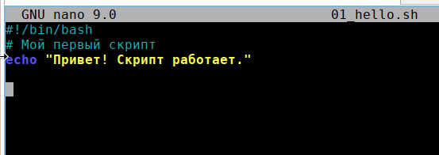

*Проверка прав (ls -l), chmod +x и запуск 01_hello.sh*

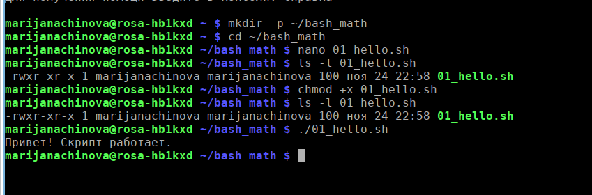

### Задание 1. Скрипт hello.sh

*Листинг hello.sh*

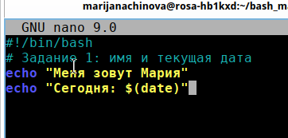

*Запуск ./hello.sh*

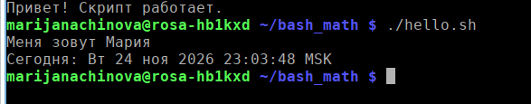

*Запуск bash hello.sh*

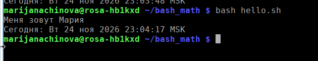

### Часть 2. Первые вычисления

*Шаги 1-2. Скрипт 02_sum.sh*

*Листинг 02_sum.sh*

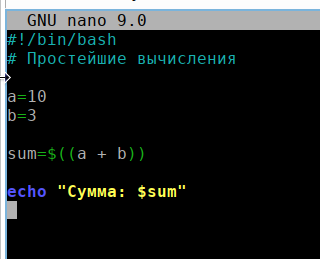

*Запуск 02_sum.sh*

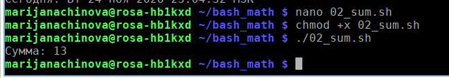

*Шаги 4-5. Скрипт 03_all_ops.sh*

*Листинг 03_all_ops.sh*

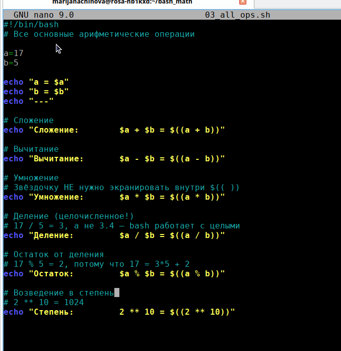

*Запуск 03_all_ops.sh*

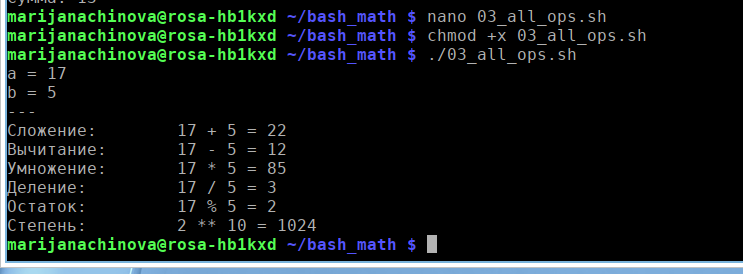

### Задание 2. Скрипт 04_my_math.sh

*Листинг 04_my_math.sh*

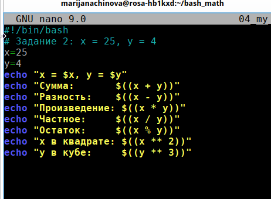

*Запуск 04_my_math.sh*

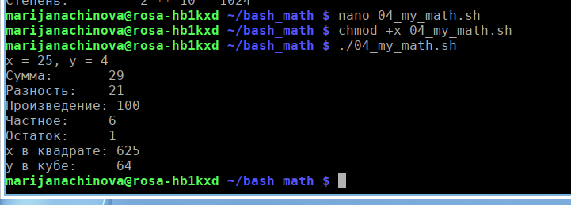

### Часть 3. Переменные и подстановка

*Шаги 1-2. Скрипт 05_vars.sh*

*Листинг 05_vars.sh*

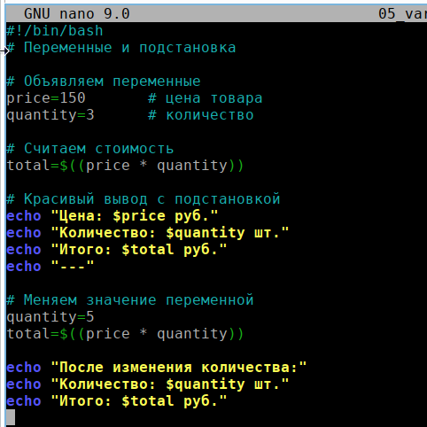

*Запуск 05_vars.sh*

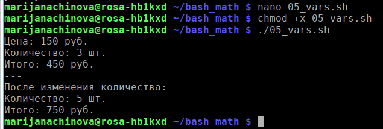

*Шаги 3-4. Скрипт 06_counter.sh*

*Листинг 06_counter.sh*

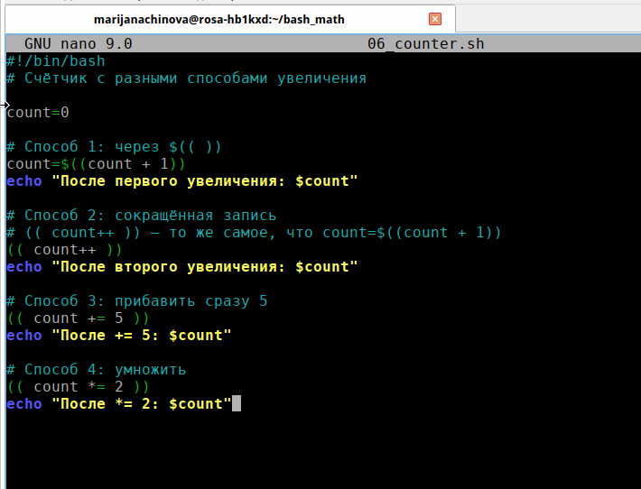

*Запуск 06_counter.sh*

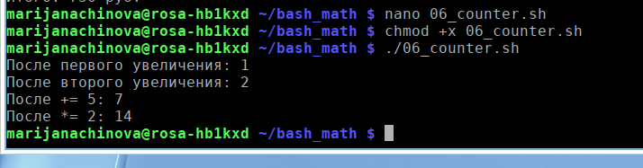

### Задание 3. Скрипт 07_rectangle.sh

*Листинг 07_rectangle.sh*

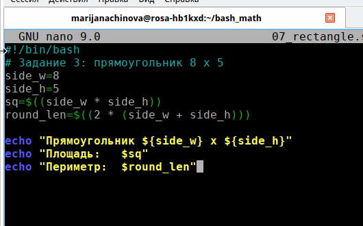

*Запуск 07_rectangle.sh*

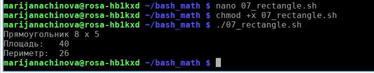

### Часть 4. Ввод чисел от пользователя

*Шаги 1-2. Скрипт 08_input.sh*

*Листинг 08_input.sh*

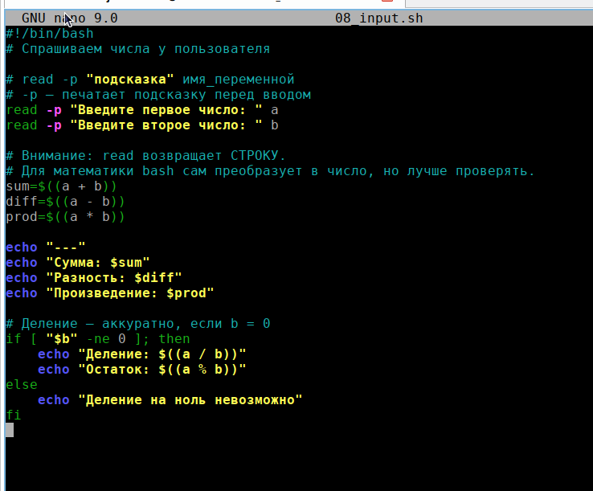

*Запуск 08_input.sh*

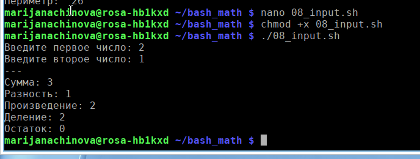

*Шаги 4-5. Простой калькулятор 09_calc.sh*

*Листинг 09_calc.sh*

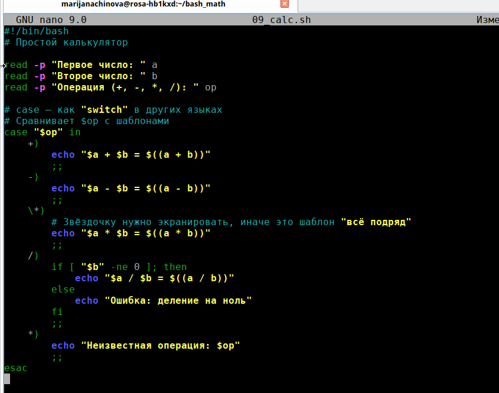

*Запуск 09_calc.sh*

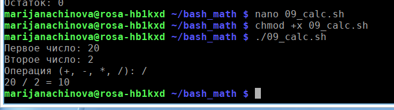

### Задание 4. Операция % в 09_calc.sh

*Листинг 09_calc.sh с веткой %*

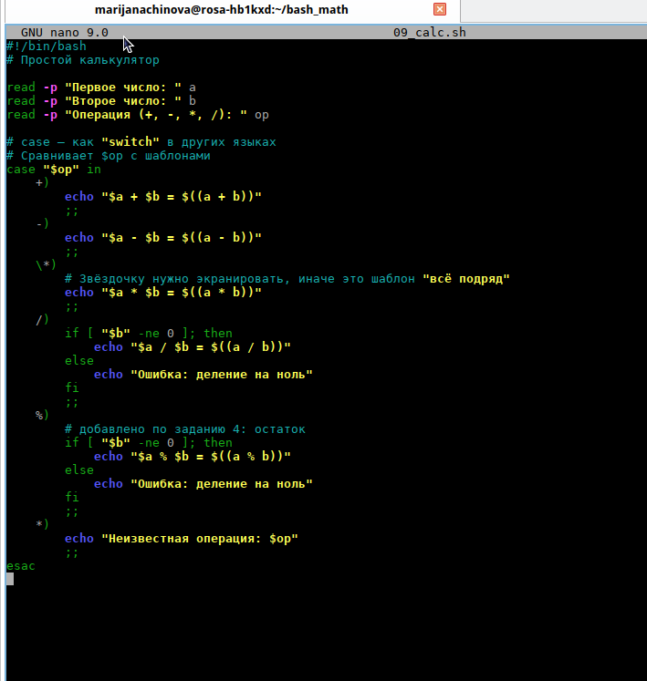

*Запуск 09_calc.sh с операцией %*

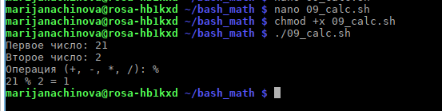

### Часть 5. Практические примеры

### Пример 1. Расчёт скидки, скрипт 10_discount.sh

*Листинг 10_discount.sh*

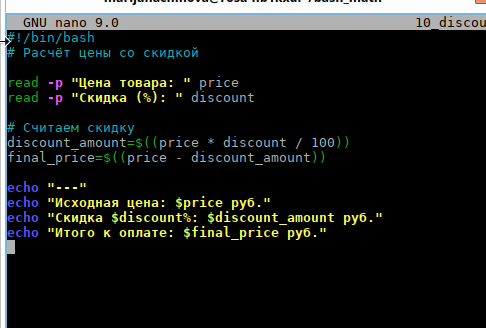

*Запуск 10_discount.sh*

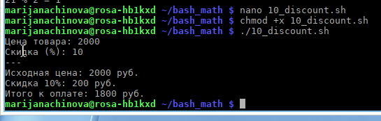

### Задание 5. Предупреждение при скидке больше 50%

*Листинг 10_discount.sh с проверкой*

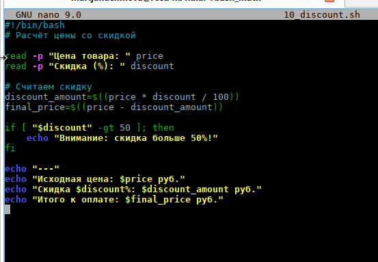

*Запуск 10_discount.sh со скидкой 70%*

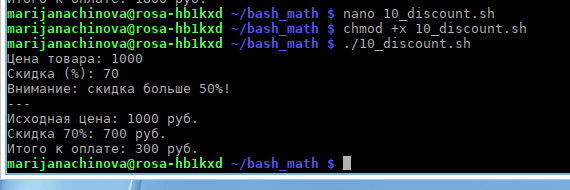

### Пример 2. Перевод секунд, скрипт 11_time.sh

*Листинг 11_time.sh*

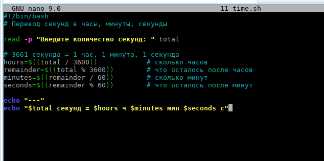

*Запуск 11_time.sh*

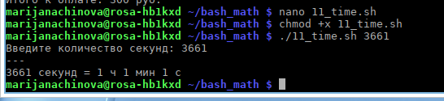

### Задание 6. Секунды аргументом

*Листинг 11_time.sh с аргументом*

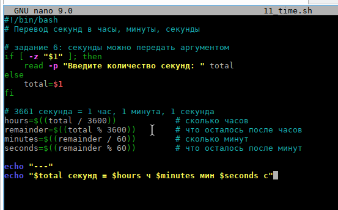

*Запуск ./11_time.sh 3661*

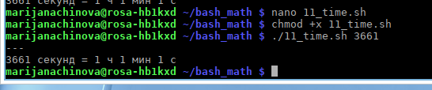

### Пример 3. Сумма чисел от 1 до N, скрипт 12_sum_range.sh

*Листинг 12_sum_range.sh*

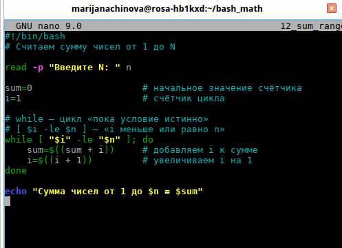

*Запуск 12_sum_range.sh*

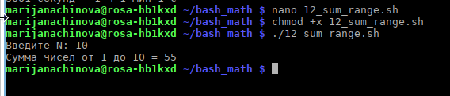

### Задание 7. Произведение чисел от 1 до N

*Листинг 12_sum_range.sh с произведением*

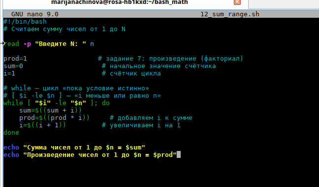

*Запуск 12_sum_range.sh с N = 10*

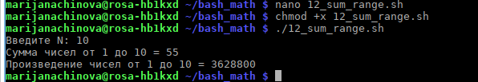

### Часть 6. Числа с плавающей точкой через bc

*Скрипт 13_float.sh*

*Листинг 13_float.sh*

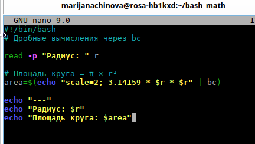

*Запуск 13_float.sh*

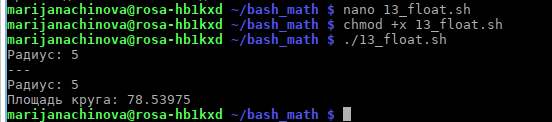

### Задание 8. Скрипт 14_average.sh

*Листинг 14_average.sh*

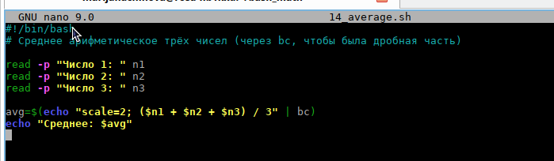

*Запуск 14_average.sh*

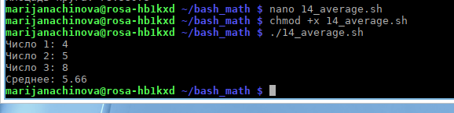

#### Дополнительное задание

*Скрипт hw_1.sh*

*Листинг hw_1.sh*

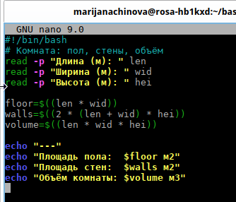

*Запуск hw_1.sh*

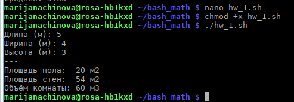

*Скрипт hw_2.sh*

*Листинг hw_2.sh*

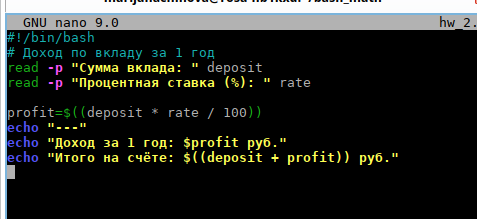

*Запуск hw_2.sh*

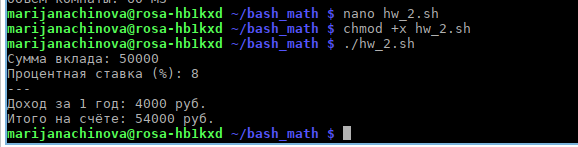

*Скрипт hw_3.sh*

*Листинг hw_3.sh*

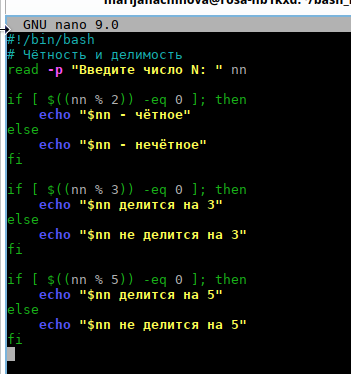

*Запуск hw_3.sh*

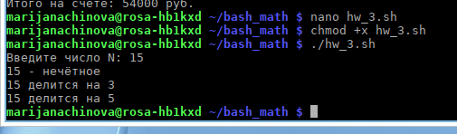

*Скрипт hw_4.sh*

*Листинг hw_4.sh*

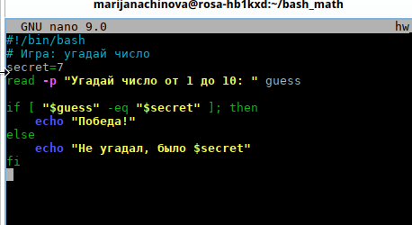

*Запуск hw_4.sh: победа и проигрыш*

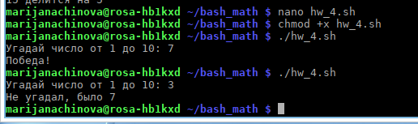

---

## Контрольные вопросы

### 1. Почему в bash нельзя написать a = 10 с пробелами? Что произойдёт?

С пробелами bash считает a командой, а = и 10 её аргументами: a: command not found.

### 2. Почему $((10 / 3)) возвращает 3, а не 3.33?

$(( )) работает только с целыми, деление отбрасывает дробную часть.

### 3. Чем $(( ... )) отличается от $( ... )?

$(( )) - арифметика, $( ) - подстановка вывода команды.

### 4. Что делает read -p "текст: " x?

Выводит подсказку и записывает введённое значение в переменную.

### 5. Что произойдёт, если поделить на ноль в bash? Почему это нужно проверять?

Ошибка division by 0, скрипт прервётся; проверка нужна для понятного сообщения.

### 6. Зачем в [ "$b" -ne 0 ] нужны кавычки вокруг $b?

Если переменная пуста, без кавычек условие [ -ne 0 ] ломается; кавычки сохраняют пустую строку как аргумент.

### 7. Как посчитать дробные числа в bash?

Через bc: echo "scale=2; 10/3" | bc.

### 8. Что означает ;; в конструкции case?

Конец ветки case (как break).

### 9. Какие три действия нужно выполнить в nano, чтобы сохранить файл и выйти?

Ctrl+O, Enter, Ctrl+X.

### 10. Что произойдёт, если нажать Ctrl+X без сохранения и ответить N?

Nano спросит про сохранение; ответ N - выход без сохранения, набранное теряется.

---

## Вывод

Я создала и запустила скрипты 01-14 и четыре дополнительных, освоила арифметику bash, ввод данных, ветвления, циклы и вычисления с дробными числами через bc.
