# Практическая работа

## Работа с файлами и сетью в bash

МДК 02.01 · Технология и инструментальные средства разработки ПО

**Выполнила:** ст. гр. 3-ИСП9-54 Начинова М. Д.  
**Проверила:** преподаватель Кондыбаева А. Б.

*Москва, 2026*

---

**Цель.** Научиться писать bash-скрипты для работы с файлами и сетью: информация о файле, создание и копирование, поиск, права доступа, IP, ping, порты, загрузка, соединения, DNS и простые утилиты.

## Ход выполнения

### 1. Работа с файлами

#### fileinfo.sh - информация о файле

*Листинг fileinfo.sh*

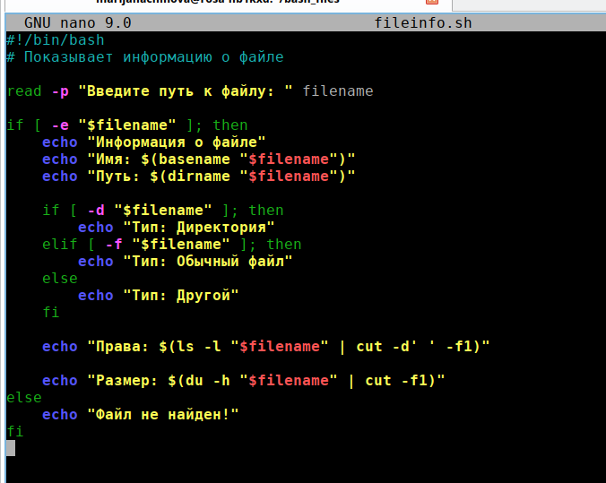

*Запуск ./fileinfo.sh*

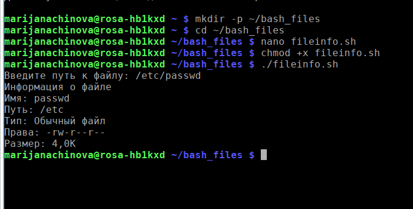

#### filecreate.sh - создание файлов

*Листинг filecreate.sh*

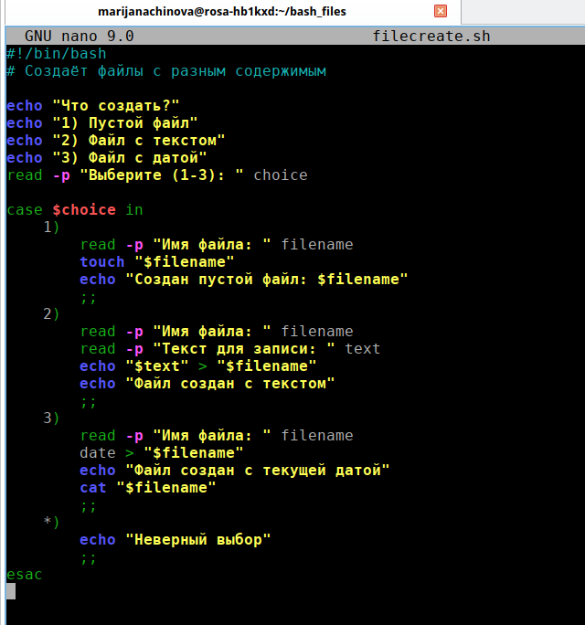

*Запуск ./filecreate.sh*

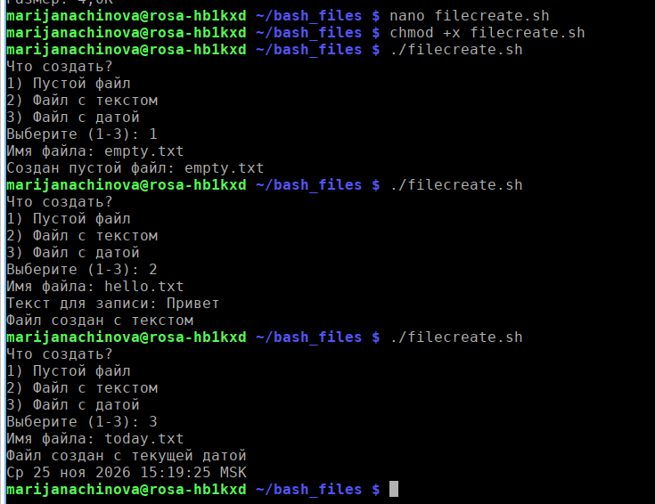

#### copybackup.sh - копирование с резервной копией

*Листинг copybackup.sh*

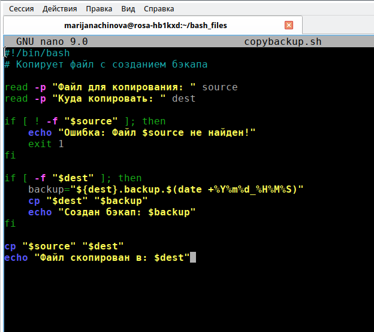

*Запуск ./copybackup.sh*

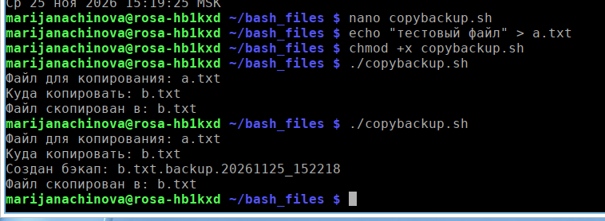

#### filefind.sh - поиск файлов

*Листинг filefind.sh*

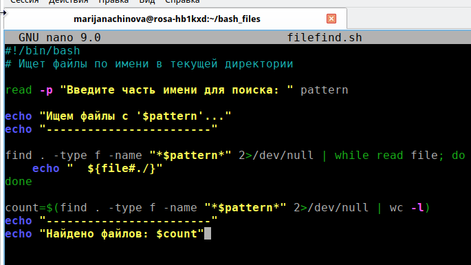

*Запуск ./filefind.sh*

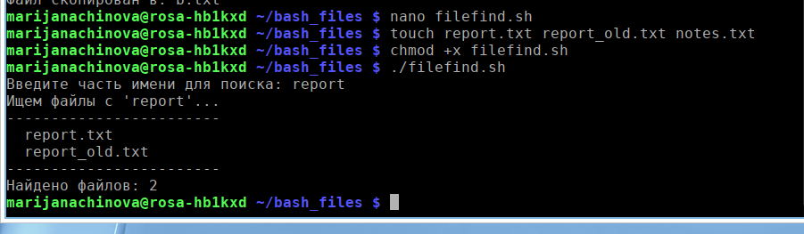

#### filepermissions.sh - изменение прав

*Листинг filepermissions.sh*

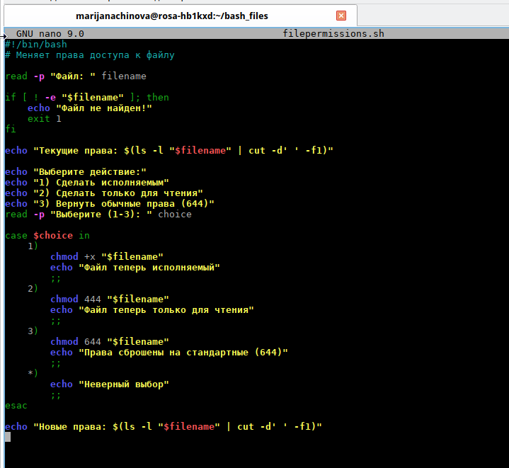

*Запуск ./filepermissions.sh*

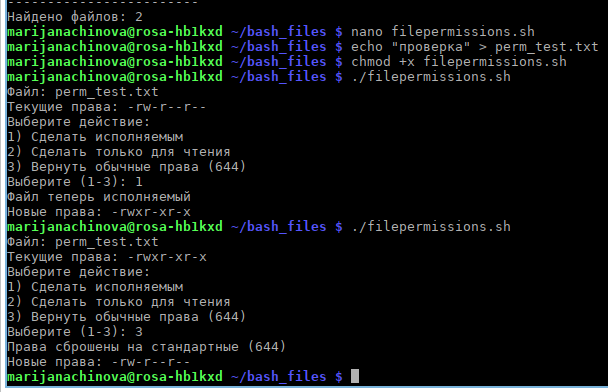

### 2. Работа с сетью

#### myip.sh - мой IP-адрес

*Листинг myip.sh*

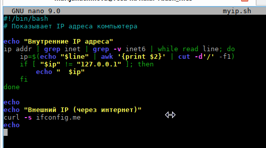

*Запуск ./myip.sh*

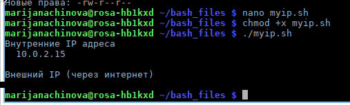

#### pingtest.sh - проверка соединения

*Листинг pingtest.sh*

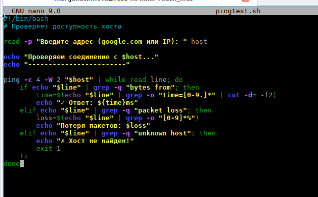

*Запуск ./pingtest.sh*

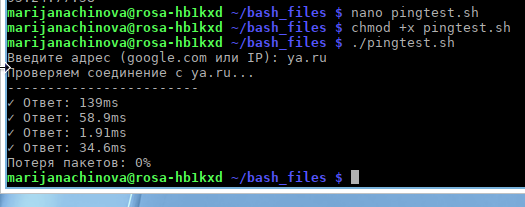

#### portscan.sh - открытые порты

*Листинг portscan.sh*

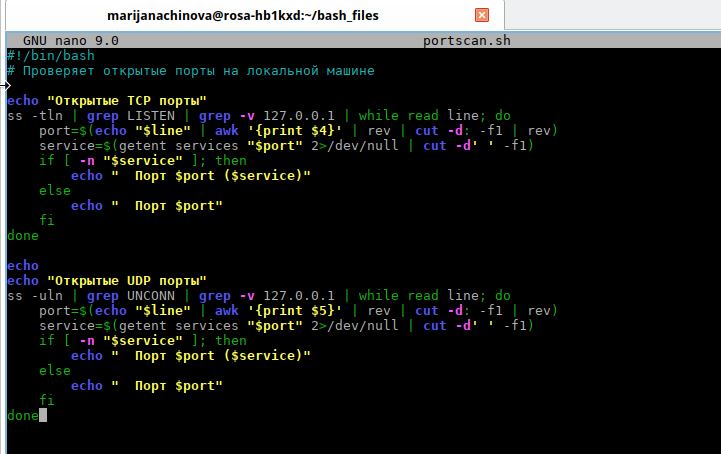

*Запуск ./portscan.sh*

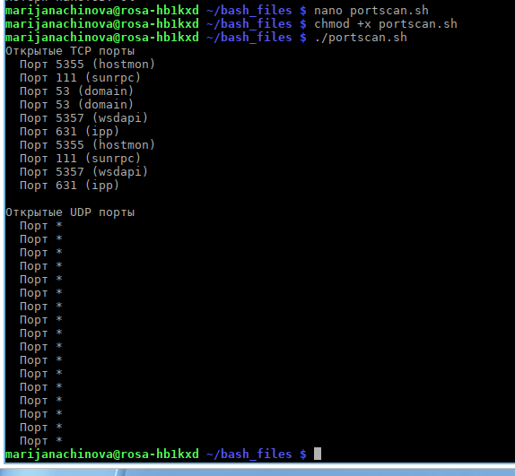

#### download.sh - загрузка файла

*Листинг download.sh*

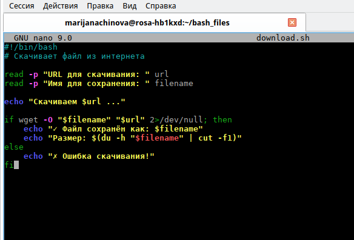

*Запуск ./download.sh*

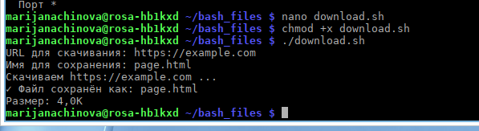

#### netstat.sh - сетевые соединения

*Листинг netstat.sh*

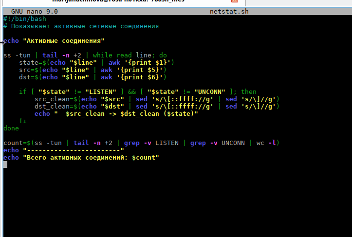

*Запуск ./netstat.sh*

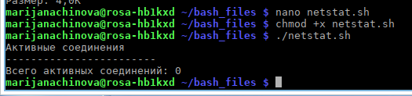

#### dnslookup.sh - DNS-запрос

*Листинг dnslookup.sh*

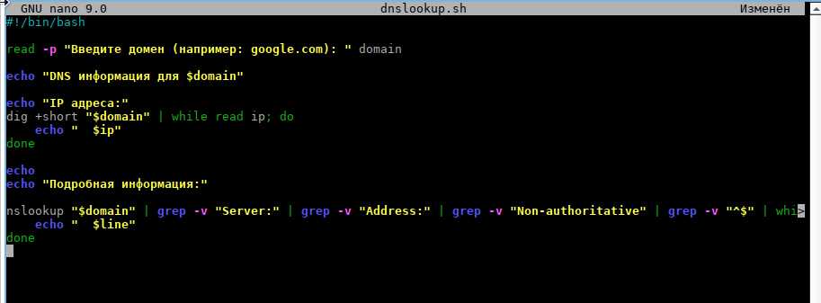

*Запуск ./dnslookup.sh*

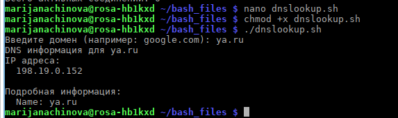

#### speedtest.sh - тест скорости

*Листинг speedtest.sh*

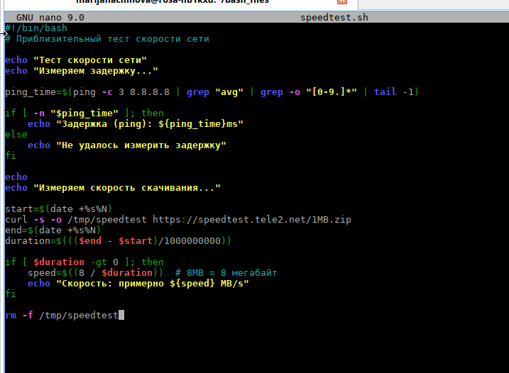

*Запуск ./speedtest.sh*

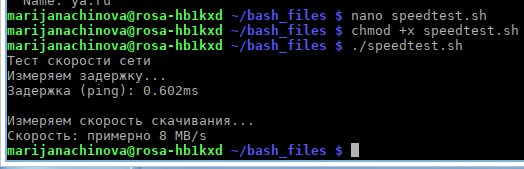

### 3. Простые полезные скрипты

#### counter.sh - счётчик

*Листинг counter.sh*

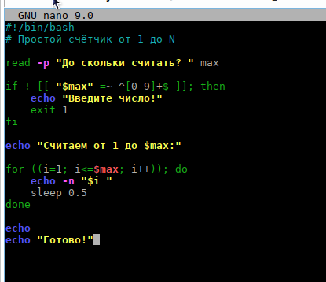

*Запуск ./counter.sh*

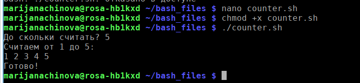

#### watcher.sh - наблюдение за файлом

*Листинг watcher.sh*

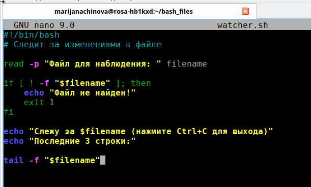

*Запуск ./watcher.sh*

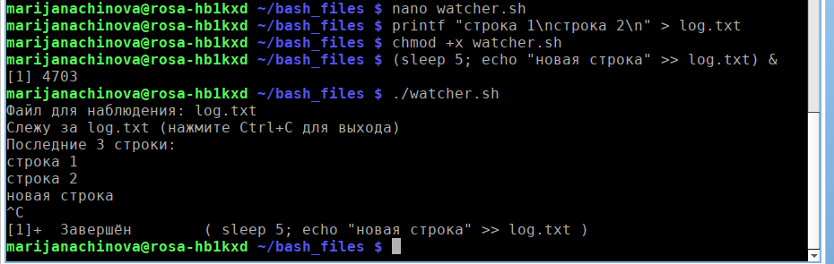

#### menu.sh - меню

*Листинг menu.sh*

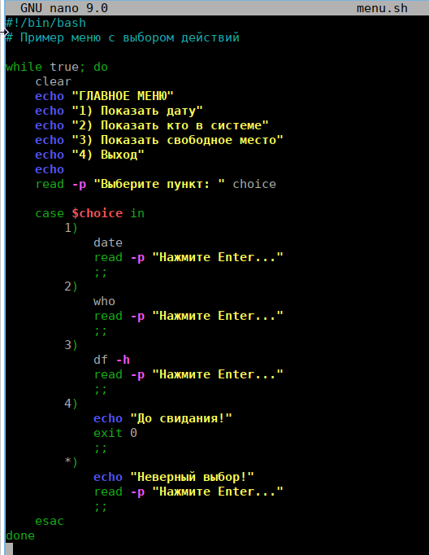

*Запуск ./menu.sh*

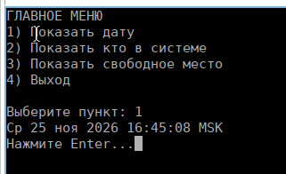

---

## Вывод

Я написала и запустила 15 скриптов в папке ~/bash_files: пять для файлов, семь для сети и три служебных. Проверила создание файлов, права доступа, поиск, копирование с резервной копией, получение IP, ping, просмотр портов, загрузку страницы, DNS и меню.
