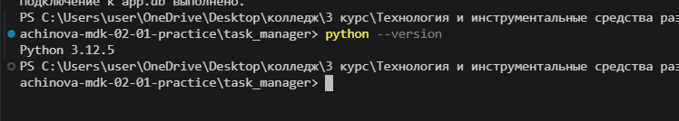
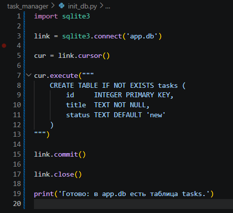
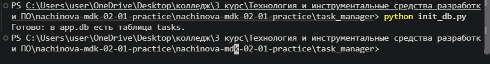
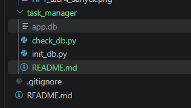
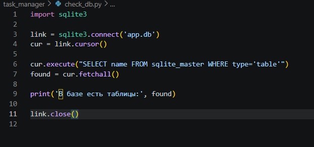
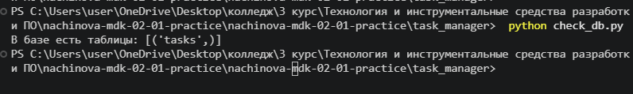
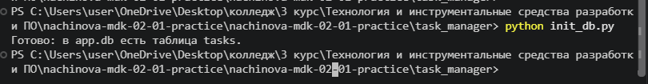
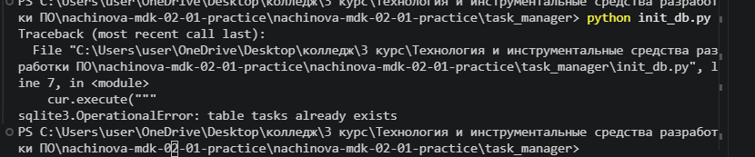

# Практическая работа №1

## Инициализация базы данных SQLite

МДК 02.01 · Технология и инструментальные средства разработки ПО

**Выполнила:** ст. гр. 3-ИСП9-54 Начинова М. Д.  
**Проверила:** преподаватель Кондыбаева А. Б.

*Москва, 2026*

---

**Цель.** Научиться создавать файл базы данных SQLite и таблицу из Python-скрипта, понять, где физически хранятся данные и зачем нужен commit.

## Ход выполнения

### Шаг 2. Проверка наличия модуля sqlite3

*Проверка версии Python*

### Шаг 3. Написание скрипта init_db.py

*Код файла init_db.py*

### Шаг 4. Запуск скрипта

*Запуск init_db.py, таблица создана*

### Шаг 5. Проверка результата

*Файл app.db появился в папке проекта*

### Шаг 6. Проверка структуры базы

*Код файла check_db.py*

*Результат check_db.py: в базе есть таблица tasks*

### Шаг 7. Проверка идемпотентности

*Повторный запуск init_db.py без ошибки*

*Ошибка при повторном создании таблицы без IF NOT EXISTS*

---

## Контрольные вопросы

### 1. Что произойдёт, если убрать conn.commit() из скрипта и запустить его?

Без commit() таблица не запишется в файл: при закрытии соединения изменения откатятся, таблицы не будет.

### 2. Чем отличается connection от cursor? Зачем нужны оба?

Соединение - канал к файлу БД (commit/rollback). Курсор создаётся из соединения и выполняет SQL-запросы. Нужны оба: курсор шлёт команды, соединение их фиксирует.

### 3. Почему id INTEGER PRIMARY KEY заполняется автоматически, хотя мы не передаём значение?

В SQLite INTEGER PRIMARY KEY - псевдоним внутреннего rowid: если значение не передано, база сама берёт следующее число (1, 2, 3...).

### 4. Что делает DEFAULT 'new' в определении колонки status?

DEFAULT 'new' подставляет 'new' в status, если при вставке значение не указано.

### 5. Где физически на диске лежат данные таблицы tasks?

В одном файле app.db в папке, откуда запускали скрипт (путь app.db относительный).

---

## Вывод

В ходе работы я создала базу данных SQLite и таблицу tasks, проверила структуру таблицы и убедилась, что скрипт инициализации можно запускать повторно. Я поняла роль commit и разницу между соединением и курсором.
