# Практическая работа №2

## Базовые CRUD-операции через консоль

МДК 02.01 · Технология и инструментальные средства разработки ПО

**Выполнила:** ст. гр. 3-ИСП9-54 Начинова М. Д.  
**Проверила:** преподаватель Кондыбаева А. Б.

*Москва, 2026*

---

**Цель.** Отработать вставку, чтение, обновление и удаление данных в таблице tasks через консольный скрипт.

## Ход выполнения

### Шаг 2. Каркас приложения с меню

*Код файла crud_console.py: каркас с меню*

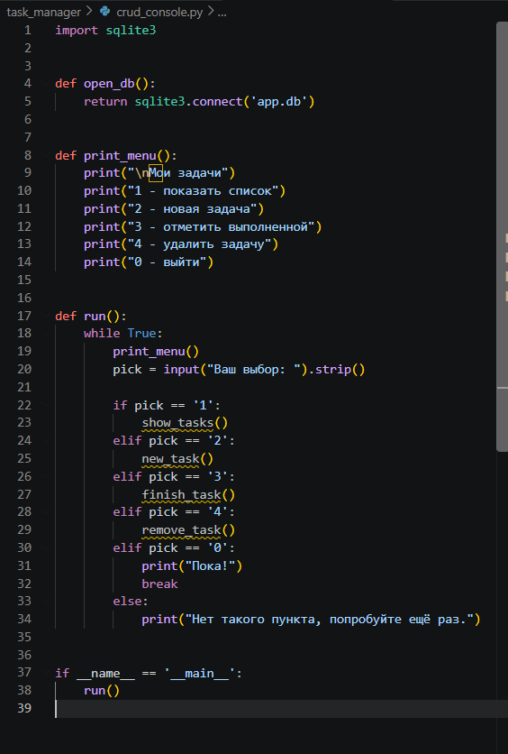

*Меню приложения и выход по пункту 0*

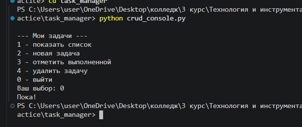

### Шаг 3. READ - показать все задачи

*Код файла crud_console.py: показ задач (READ)*

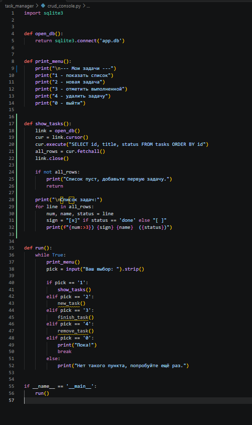

*Пункт 1 при пустой таблице*

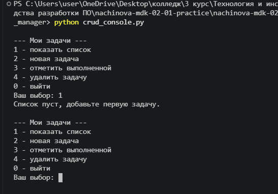

### Шаг 4. CREATE - добавить задачу

*Код файла crud_console.py: добавление задачи (CREATE)*

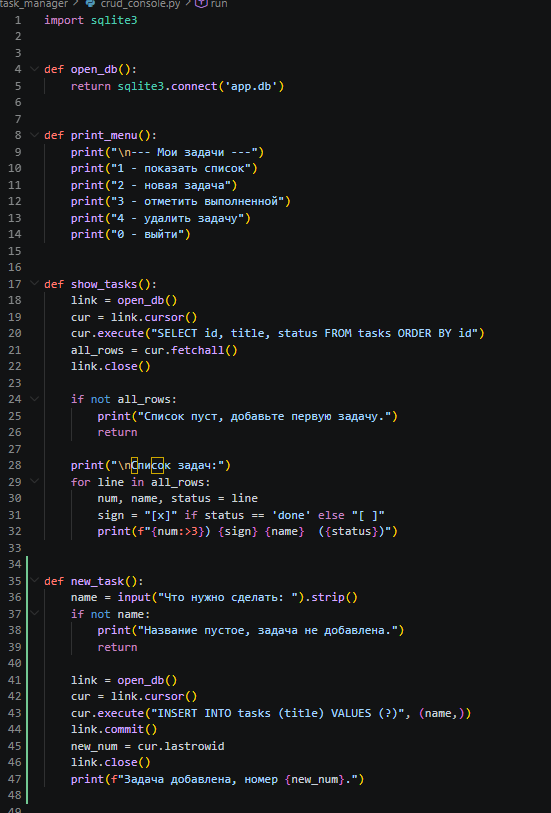

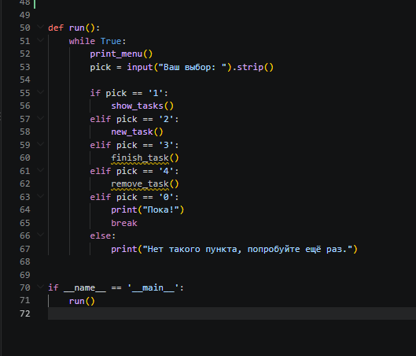

### Шаг 5. UPDATE - отметить задачу выполненной

*Код файла crud_console.py: отметка выполненной (UPDATE)*

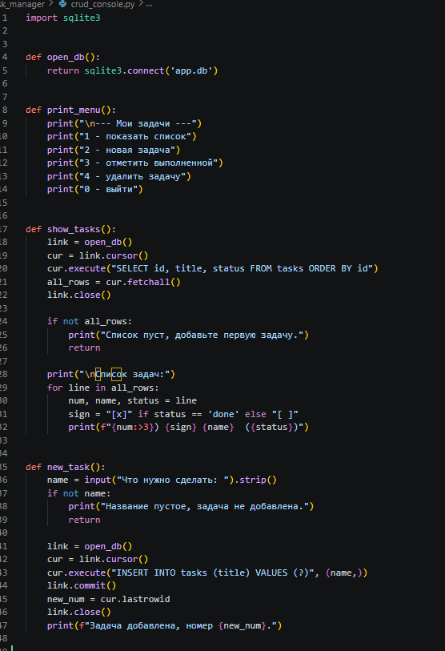

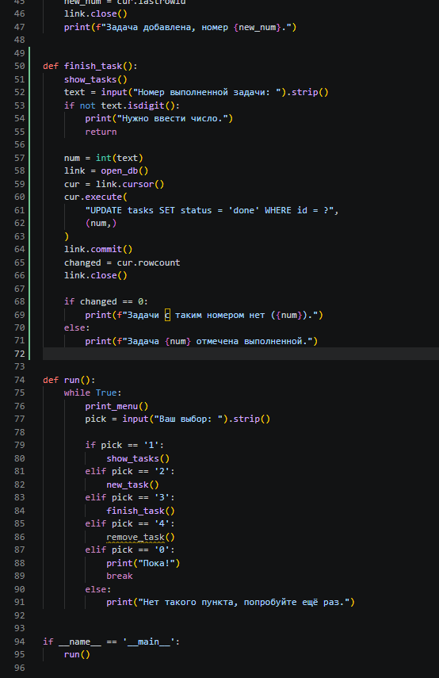

*Реакция на неверный ввод номера*

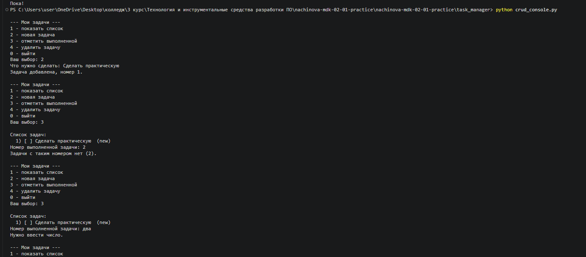

*Шаги 6-7. DELETE - удалить задачу и полный скрипт*

*Код файла crud_console.py: удаление (DELETE), полный скрипт*

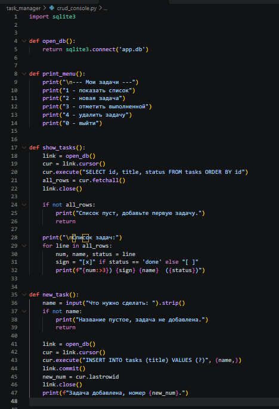

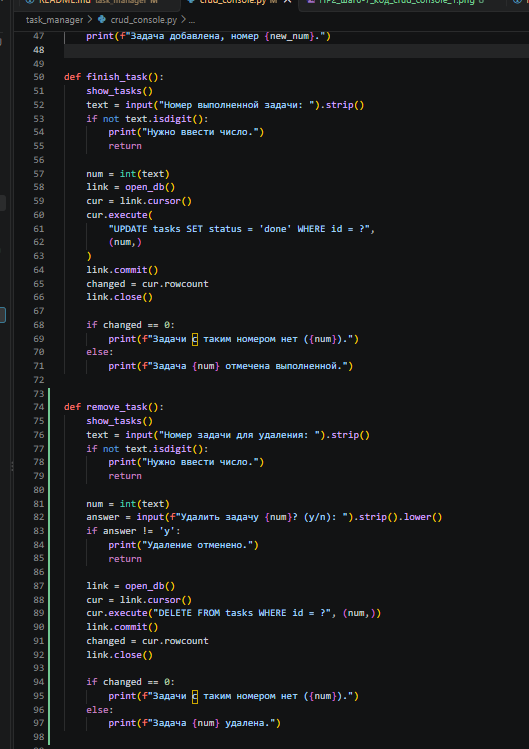

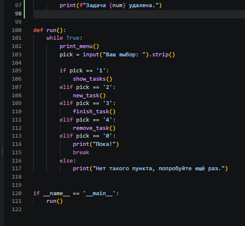

### Шаг 8. Сценарий проверки

*Добавление двух задач и список*

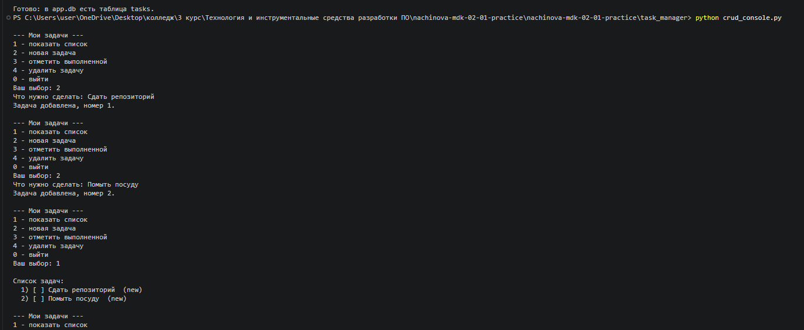

*Список после отметки первой задачи выполненной*

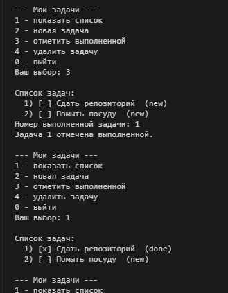

*Список после удаления второй задачи*

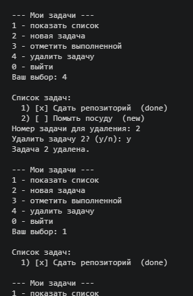

*Данные на месте после повторного запуска программы*

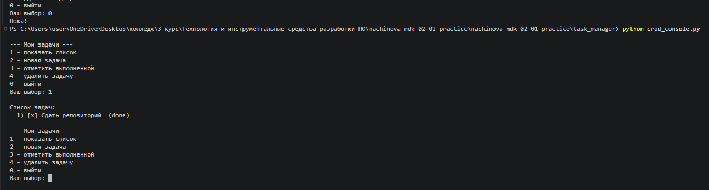

### Шаг 9. Эксперимент с SQL-инъекцией

*Строка с попыткой SQL-инъекции сохранена как обычный текст*

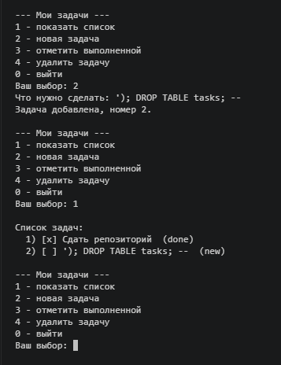

---

## Контрольные вопросы

### 1. Почему для SELECT не нужен commit(), а для INSERT - нужен?

SELECT данные не меняет, фиксировать нечего. INSERT меняет данные, и без commit() они не сохранятся.

### 2. Что вернёт fetchone(), если в таблице нет строк?

None.

### 3. Чем fetchone() отличается от fetchall() и когда какой использовать?

fetchone() возвращает одну строку, fetchall() - список всех. fetchone - когда нужна одна запись или проверка наличия, fetchall - для вывода списка.

### 4. Почему (title,) - это кортеж, а (title) - нет?

Кортеж задаёт запятая: (title,) кортеж из одного элемента, (title) - просто title в скобках.

### 5. Что вернёт cursor.rowcount после UPDATE, если такого id нет?

0: ни одна строка не изменена.

### 6. Зачем проверять isdigit() перед int(input())?

int(input()) падает с ValueError на нецифровом вводе; isdigit() позволяет заранее показать понятное сообщение.

### 7. Как параметризованные запросы защищают от SQL-инъекции?

Значения передаются отдельно от текста запроса и подставляются как данные, а не как SQL-код, поэтому ввод вида '); DROP TABLE... остаётся просто строкой.

---

## Вывод

Я реализовала все четыре операции CRUD в консоли, использовала параметризованные запросы и проверку ввода. Работа показала, что чтение не требует commit, а изменения данных без него не сохраняются.
