# Практическая работа №3

## Подключение Flask и первый маршрут (Hello World)

МДК 02.01 · Технология и инструментальные средства разработки ПО

**Выполнила:** ст. гр. 3-ИСП9-54 Начинова М. Д.  
**Проверила:** преподаватель Кондыбаева А. Б.

*Москва, 2026*

---

**Цель.** Понять, как Python-код превращается в веб-страницу: установить Flask, создать приложение и несколько маршрутов.

## Ход выполнения

### Шаг 1. Установка Flask

*Результат pip show flask*

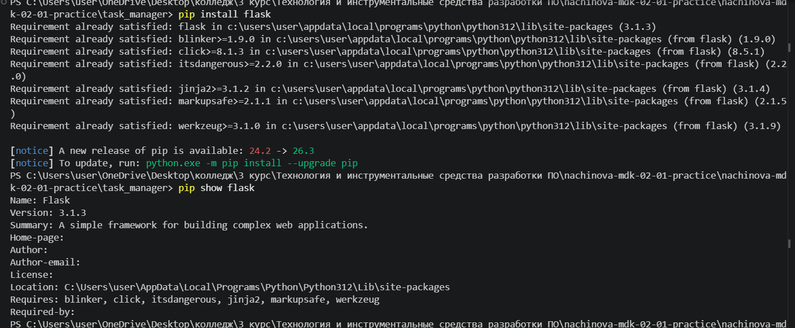

### Шаг 2. Структура проекта

*Структура проекта в VS Code*

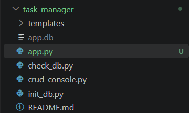

### Шаг 3. Первый маршрут

*Код файла app.py: первый маршрут*

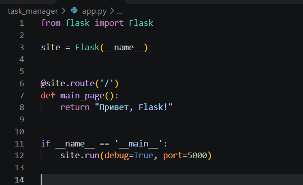

### Шаг 4. Запуск сервера

*Сервер запущен*

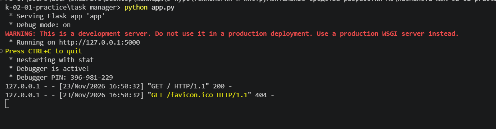

### Шаг 5. Открытие в браузере

*Страница «Привет, Flask!» в браузере*

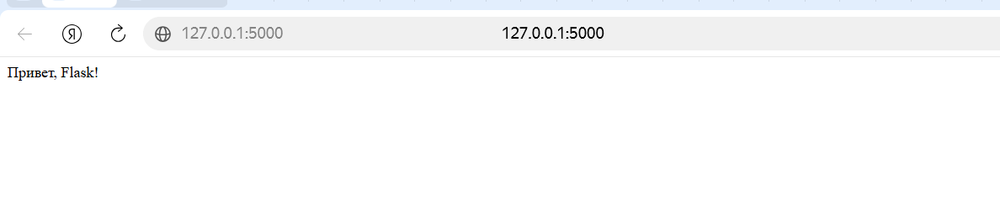

### Шаг 6. Проверка автоперезагрузки

*Автоперезагрузка сервера после изменения кода*

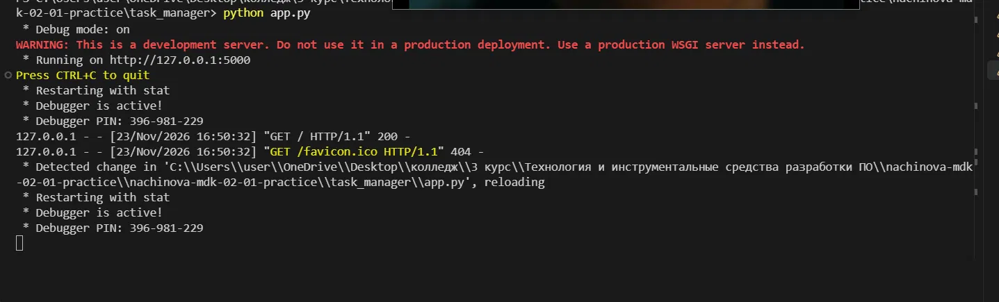

### Шаг 7. Второй маршрут

*Код файла app.py: маршрут /about*

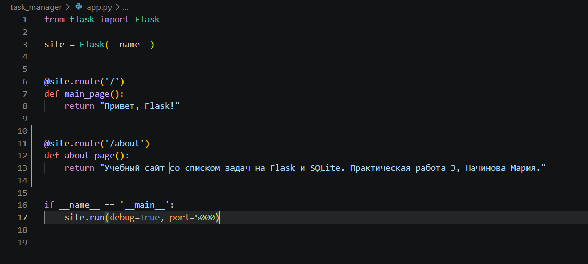

*Страница /about*

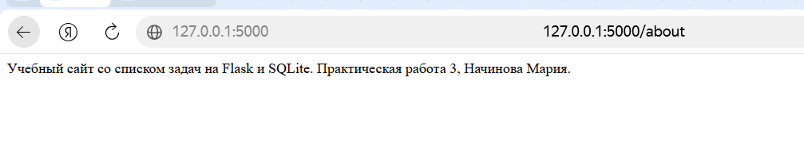

### Шаг 8. Проверка обработки ошибок 404

*Страница 404 для несуществующего адреса*

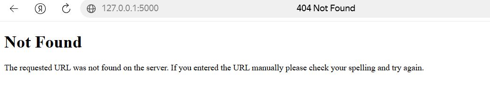

### Шаг 9. Возврат HTML-строки

*Главная страница с заголовком и ссылкой «О проекте»*

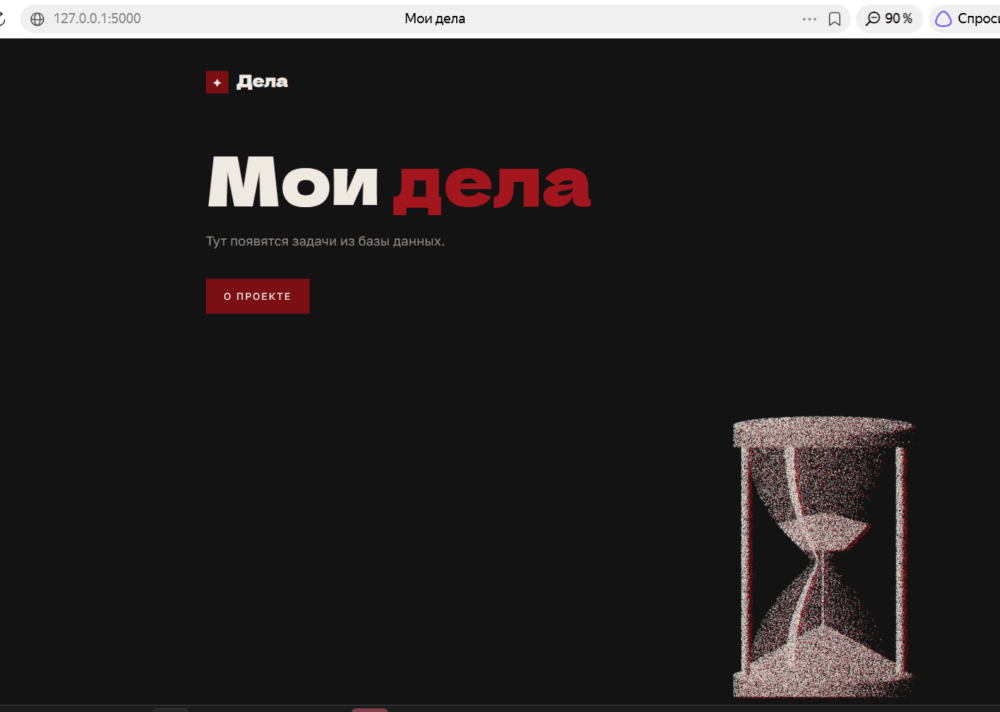

### Шаг 10. Полный код app.py

*Код файла app.py: итог работы 3*

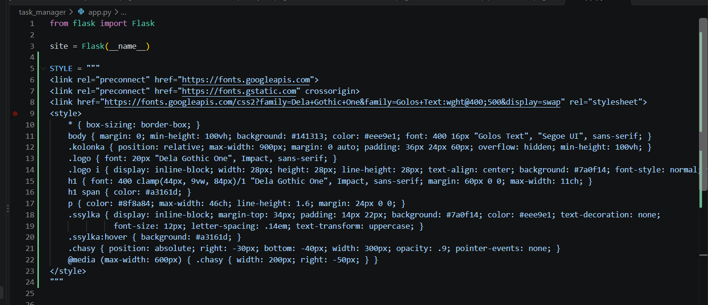

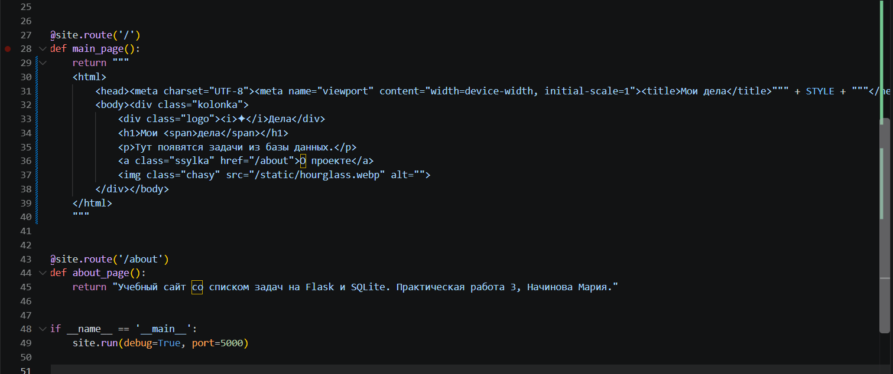

---

## Контрольные вопросы

### 1. Что делает декоратор @app.route('/')?

Привязывает URL / к функции: при запросе этого адреса Flask вызывает её и отдаёт результат браузеру.

### 2. Чем GET отличается от POST? Какой метод используется по умолчанию?

GET запрашивает страницу/данные, POST отправляет данные на сервер (формы). По умолчанию маршрут принимает только GET.

### 3. Зачем нужен debug=True и почему его нельзя использовать на реальном сервере?

debug=True включает автоперезагрузку и подробные ошибки. На реальном сервере нельзя: отладчик показывает код и позволяет выполнять его, это уязвимость.

### 4. Что означает адрес 127.0.0.1:5000?

127.0.0.1 - локальный адрес этого же компьютера (localhost), 5000 - порт сервера.

### 5. Почему при открытии /nonexistent мы получаем 404, а не ошибку Python?

Flask сам обрабатывает отсутствие маршрута и возвращает HTTP 404: страницы нет - это не ошибка программы.

### 6. Почему папка для HTML-шаблонов должна называться именно templates?

Flask по умолчанию ищет шаблоны в папке templates рядом с приложением (можно изменить параметром template_folder).

### 7. Что произойдёт, если запустить два сервера Flask одновременно на одном порту?

Второй сервер не запустится: порт занят (Address already in use).

---

## Вывод

Я установила Flask, создала приложение с двумя маршрутами, проверила обработку несуществующего адреса и автоперезагрузку в режиме debug.
