# Практическая работа №4

## Интеграция Flask и SQLite (чтение данных)

МДК 02.01 · Технология и инструментальные средства разработки ПО

**Выполнила:** ст. гр. 3-ИСП9-54 Начинова М. Д.  
**Проверила:** преподаватель Кондыбаева А. Б.

*Москва, 2026*

---

**Цель.** Научиться читать данные из SQLite в Flask-приложении и выводить их через шаблон Jinja2.

## Ход выполнения

### Шаг 2. Создание шаблона templates/index.html

*Код файла index.html*

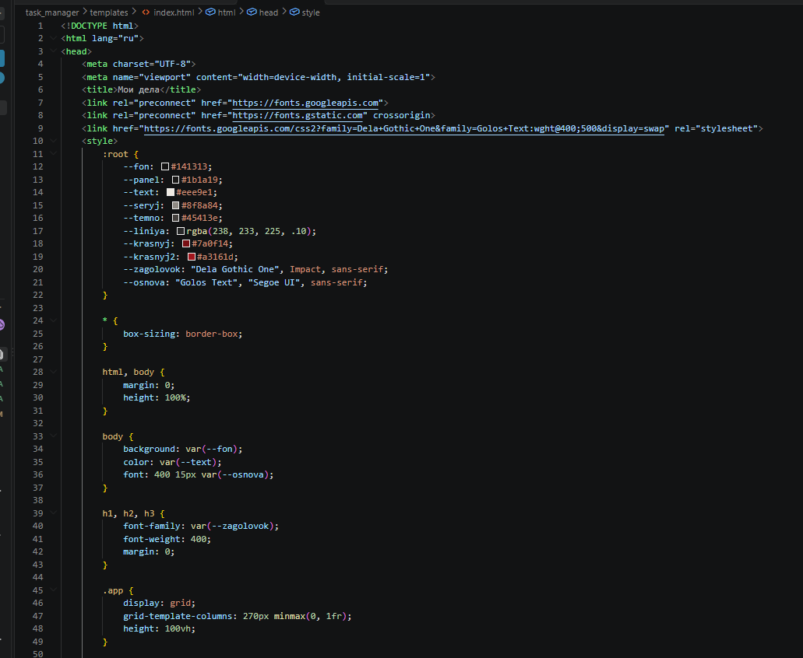

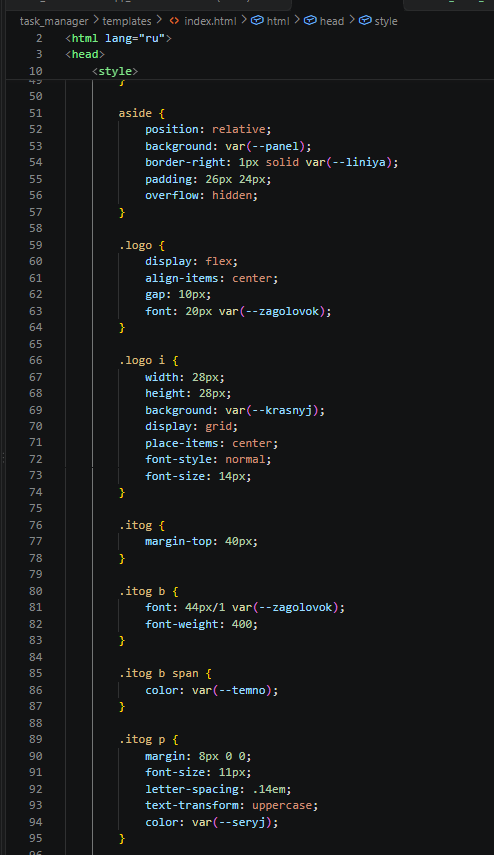

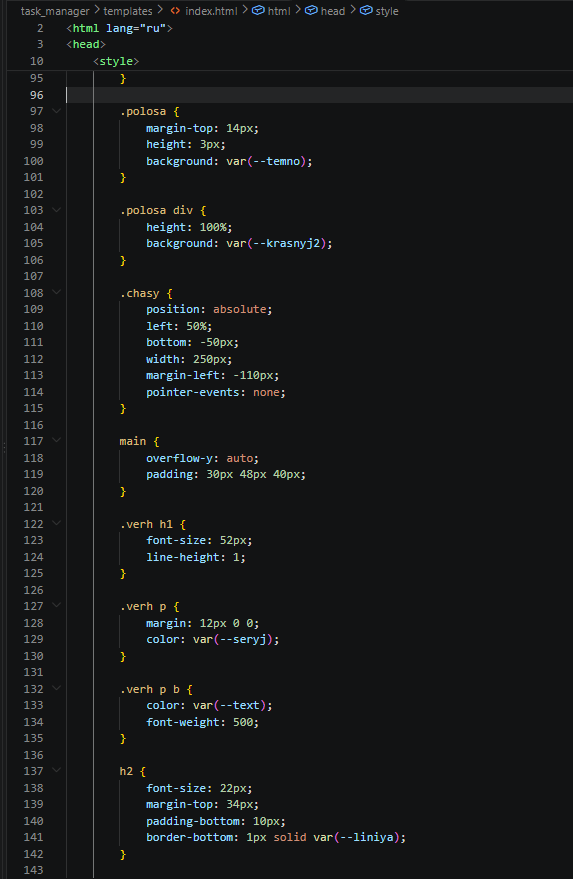

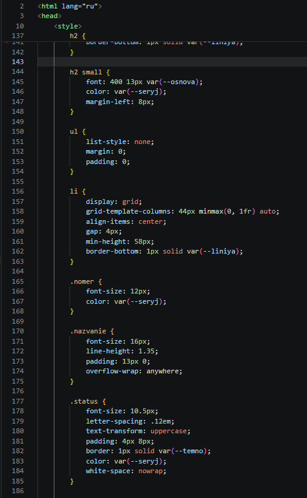

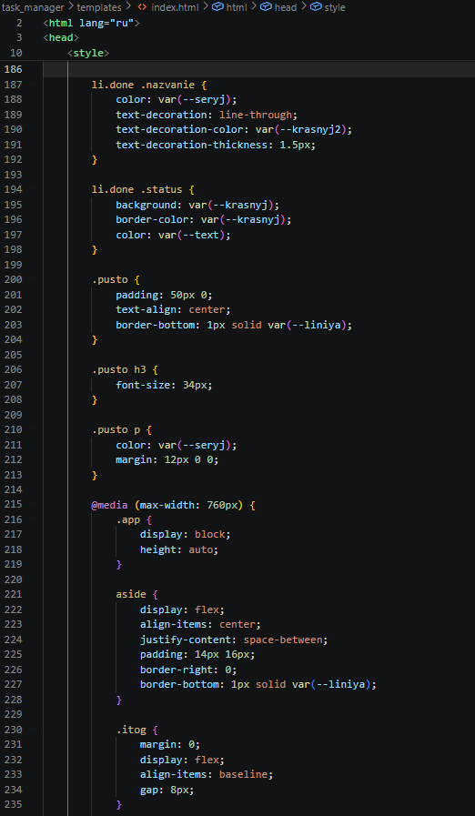

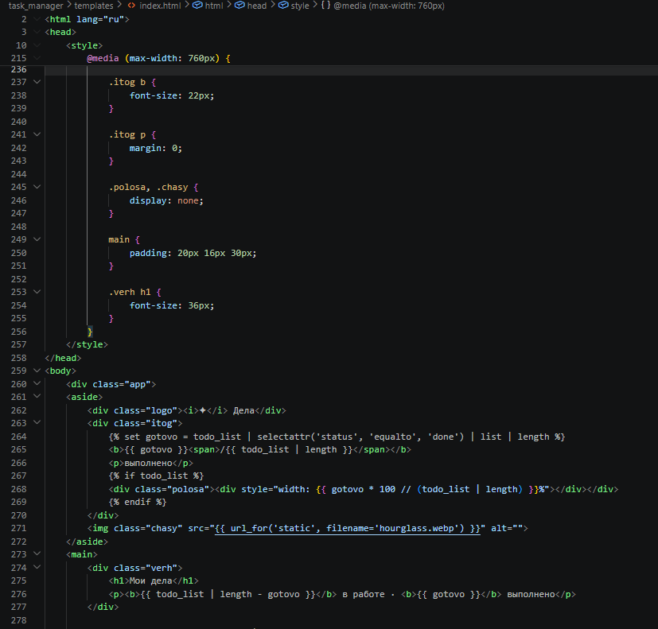

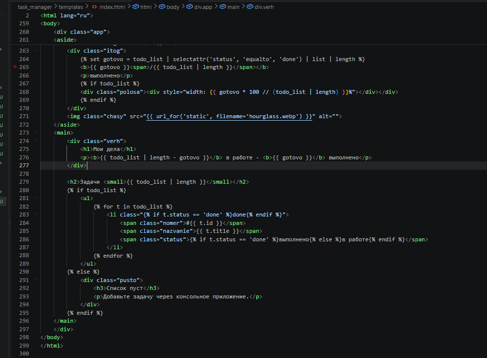

### Шаг 3. Переписываем app.py: чтение из базы

*Код файла app.py: чтение из базы*

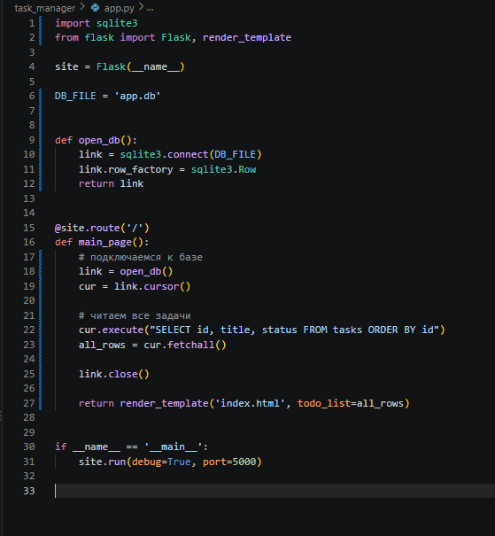

### Шаг 4. Запуск и проверка

*Список задач из базы в браузере*

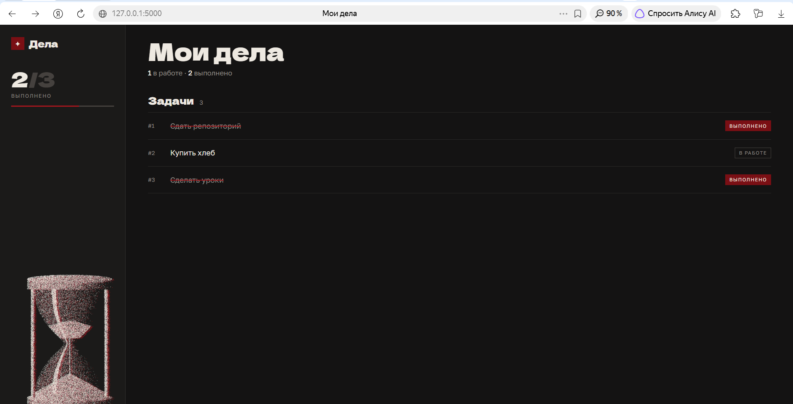

### Шаг 5. Проверка «живой» связи с базой

*Задача, добавленная через консольное приложение, появилась на странице*

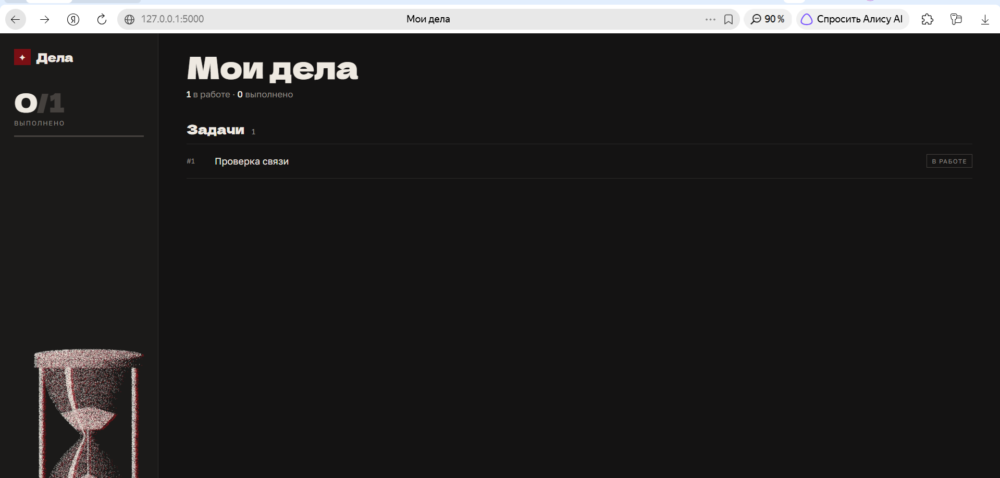

### Шаг 6. Проверка пустой базы

*Сообщение «Список пуст»*

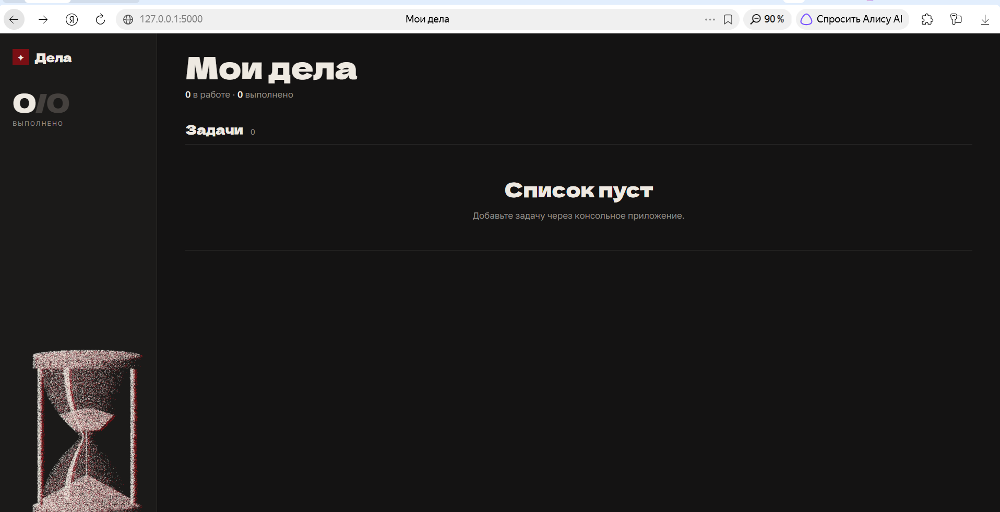

### Шаг 7. Эксперимент: sqlite3.Row и обычный кортеж

*Ошибка при убранной строке row_factory*

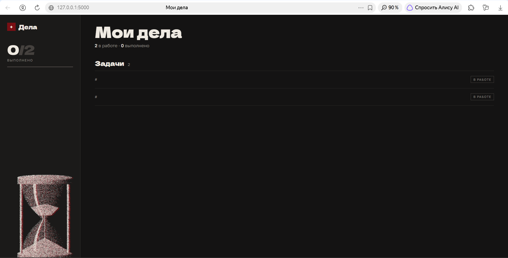

---

## Контрольные вопросы

### 1. Зачем нужен шаблонизатор Jinja2, если можно вернуть HTML-строку из функции?

Шаблонизатор отделяет HTML от Python, даёт циклы и условия в разметке, экранирует данные.

### 2. Чем {{ ... }} отличается от  в Jinja2?

{{ ... }} выводит значение,  - управляющие конструкции (for, if).

### 3. Что делает render_template('index.html', items=rows)?

Находит index.html в templates и подставляет в него данные, доступные в шаблоне как items.

### 4. Почему при чтении данных не нужен conn.commit()?

Данные только читаются, ничего не меняется.

### 5. Что такое sqlite3.Row и почему item.title работает только с ним?

sqlite3.Row - строка с доступом по имени колонки; обычный кортеж позволяет только индекс.

### 6. Куда Flask кладёт файлы шаблонов по умолчанию и можно ли это изменить?

В папку templates; можно изменить через Flask(__name__, template_folder='...').

### 7. Что выведет шаблон, если items - пустой список?

Блок else цикла/условия: сообщение «Список пуст».

---

## Вывод

Я научилась читать данные из SQLite во Flask и выводить их через Jinja2: циклы, условия и обработка пустого списка работают.
