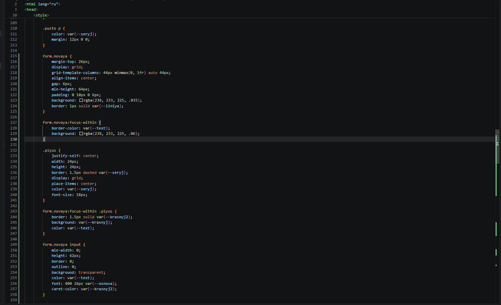
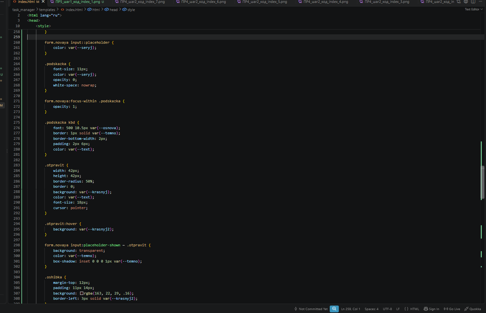
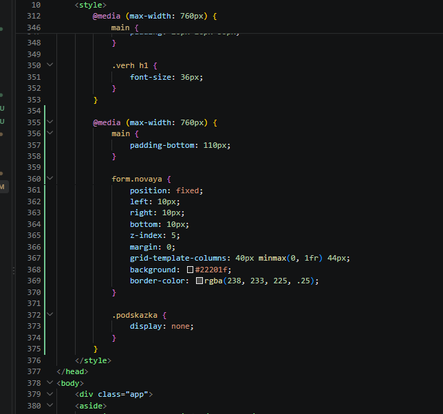
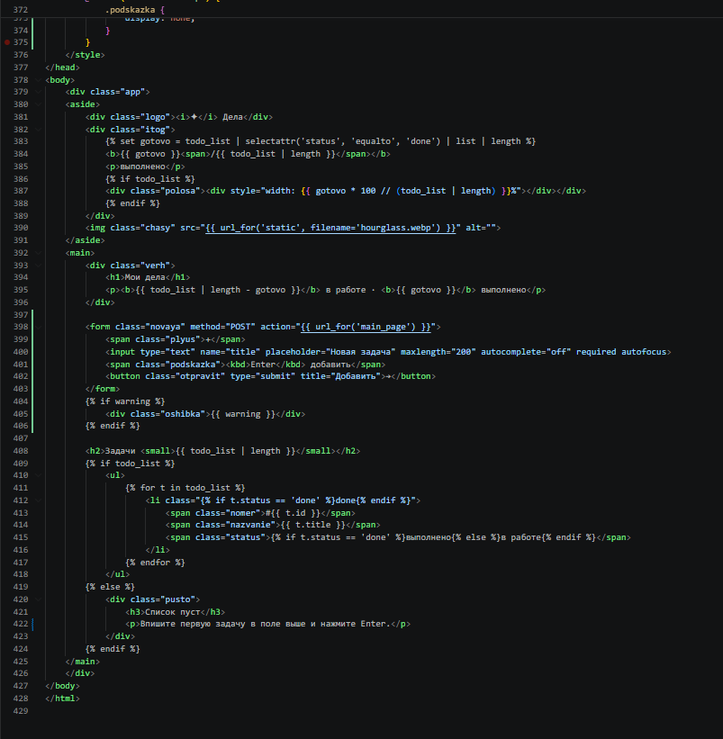
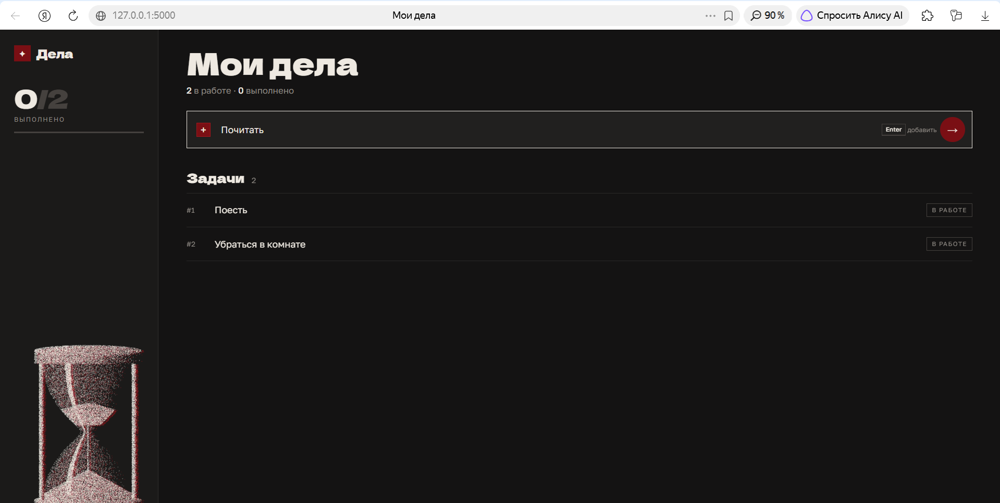
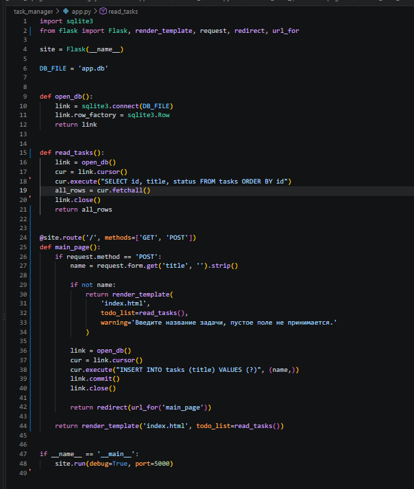
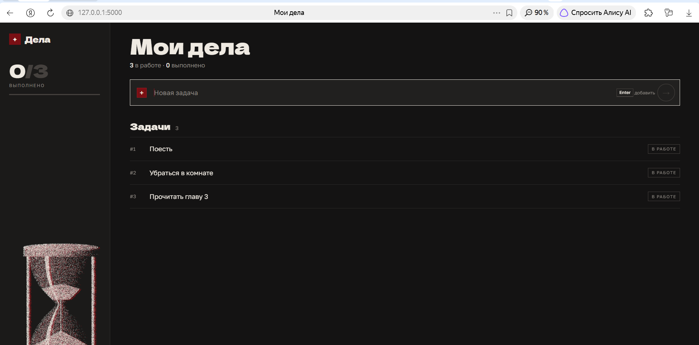
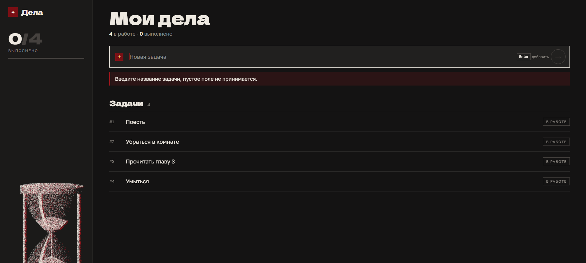
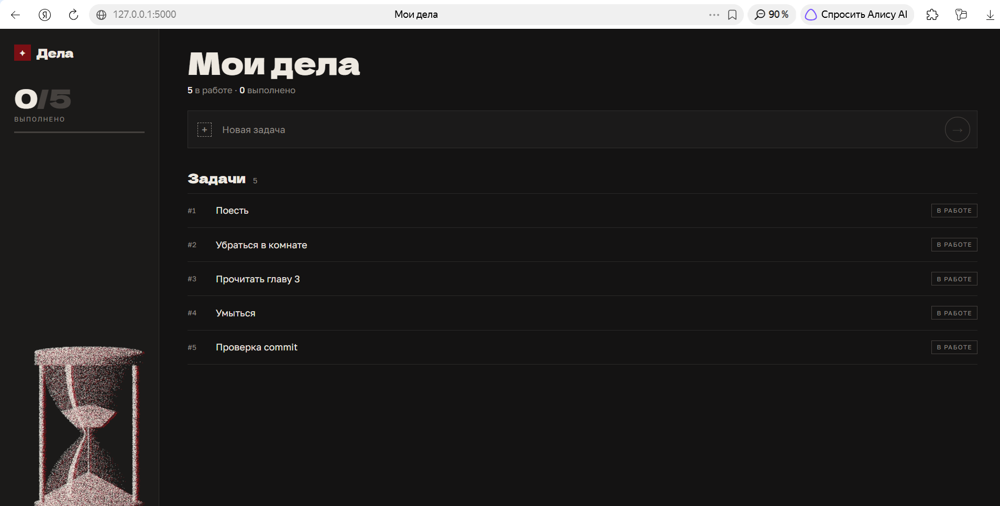
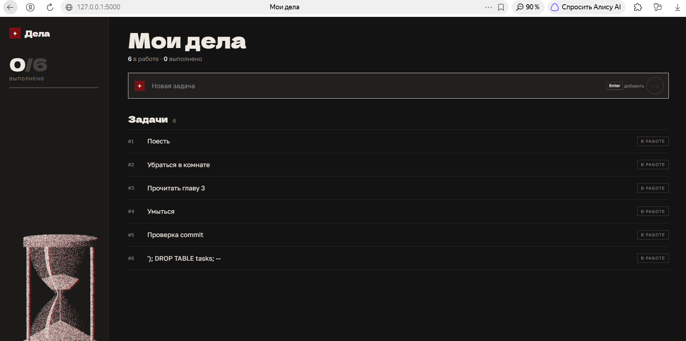

# Практическая работа №5

## Интеграция Flask и SQLite (добавление данных)

МДК 02.01 · Технология и инструментальные средства разработки ПО

**Выполнила:** ст. гр. 3-ИСП9-54 Начинова М. Д.  
**Проверила:** преподаватель Кондыбаева А. Б.

*Москва, 2026*

---

**Цель.** Научиться принимать данные из HTML-формы, сохранять их в базу и применять паттерн Post/Redirect/Get.

## Ход выполнения

### Шаг 1. Обновляем шаблон index.html: добавляем форму

*Код файла index.html*

*Страница с формой добавления*

### Шаг 2. Обновляем app.py: обработка POST и INSERT

*Код файла app.py: POST и INSERT*

### Шаг 3. Запуск и проверка

*Задача добавлена через форму*

*После F5 дубля нет*

*Попытка отправить пустое поле*

### Шаг 4. Проверка порядка транзакций

*Задача на месте после перезапуска сервера*

### Шаг 5. Эксперимент с SQL-инъекцией

*Строка с попыткой инъекции сохранена как текст*

---

## Контрольные вопросы

### 1. Чем POST принципиально отличается от GET и почему формы отправляют именно POST?

GET передаёт данные в адресе и не должен менять состояние; POST - в теле запроса, для изменения данных. Форма с изменением данных отправляет POST.

### 2. Что произойдёт, если убрать methods=['GET', 'POST'] из маршрута?

Маршрут будет принимать только GET, а форма даст ошибку 405 Method Not Allowed.

### 3. Зачем нужен паттерн Post/Redirect/Get? Что сломается без него?

После POST делаем редирект на GET-страницу. Без этого F5 повторно отправит форму и задача продублируется.

### 4. Почему url_for('index') лучше, чем жёсткая строка '/'?

url_for строится по имени функции: при смене адреса маршрута ничего не сломается.

### 5. Почему request.form.get('title', '') безопаснее, чем request.form['title']?

get с значением по умолчанию не падает с ошибкой 400, если поля нет в запросе.

### 6. Зачем нужна серверная валидация, если в HTML уже есть required?

required проверяет только браузер, запрос можно отправить в обход (curl, правка страницы). Проверка на сервере обязательна.

### 7. В каком порядке идут транзакции при добавлении задачи через форму?

Открыть соединение, выполнить INSERT, commit, закрыть соединение, редирект.

---

## Вывод

Я реализовала добавление задач через форму с серверной валидацией, защитой от SQL-инъекций и редиректом после POST.
