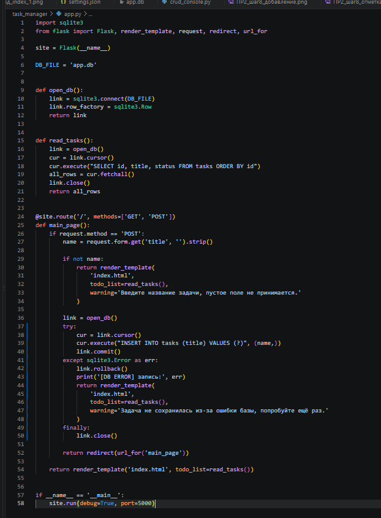
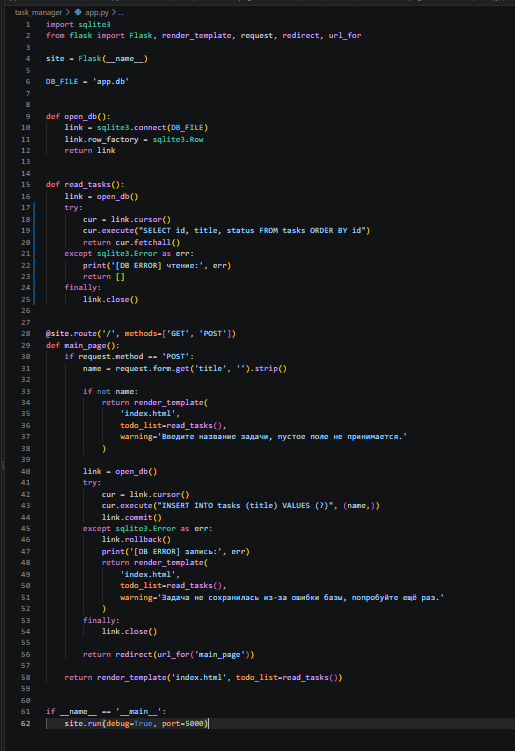
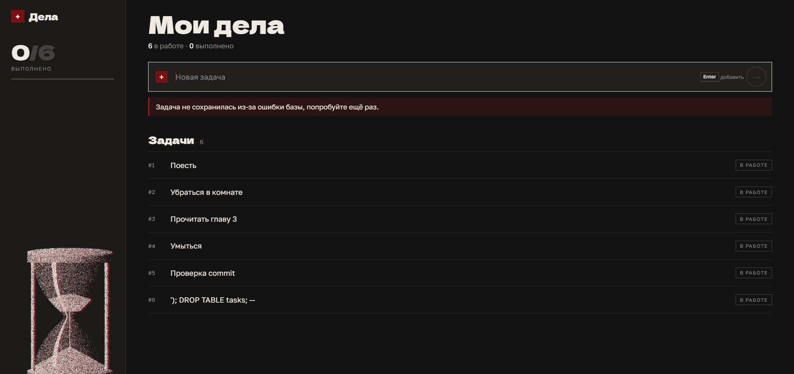
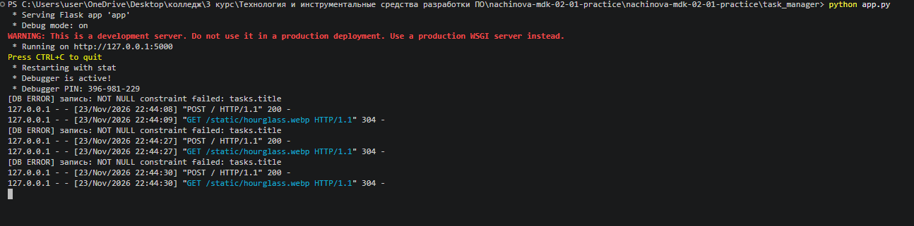
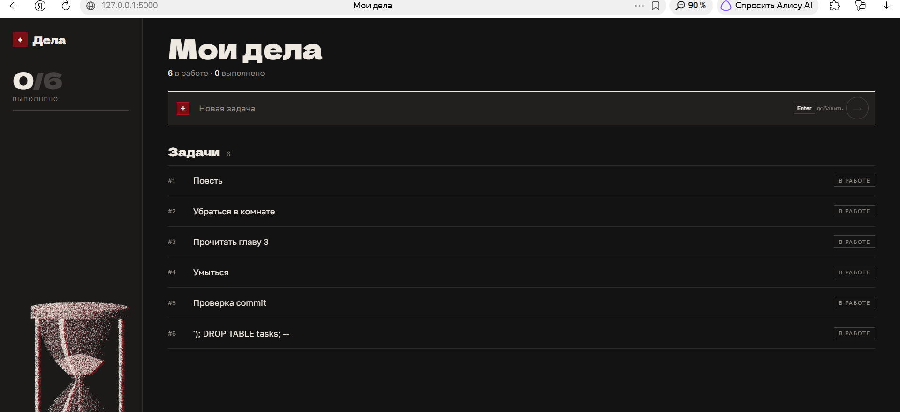
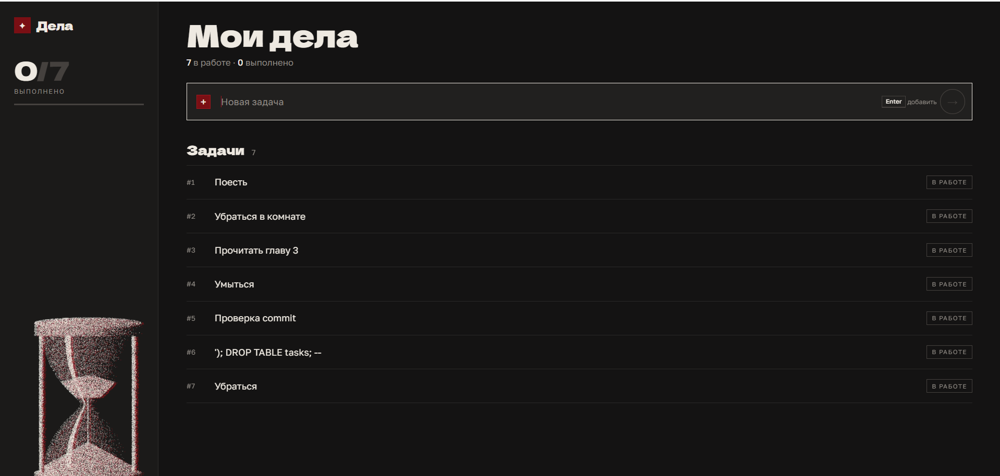
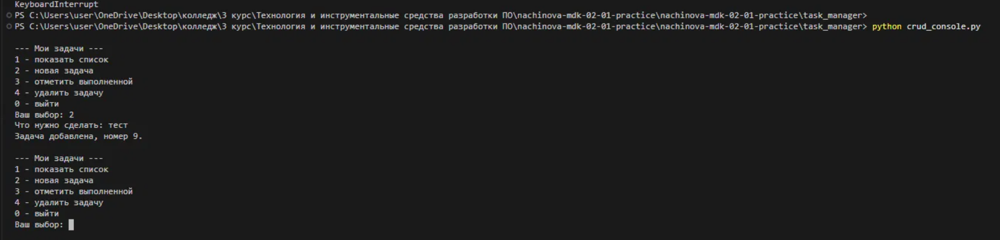
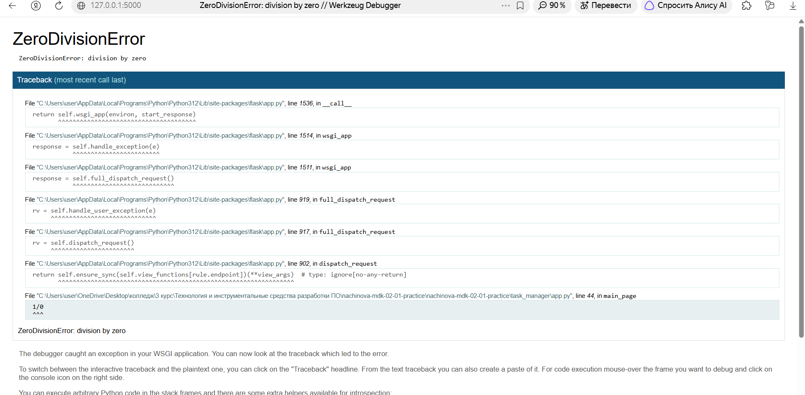

# Практическая работа №6

## Обработка ошибок и защита соединений

МДК 02.01 · Технология и инструментальные средства разработки ПО

**Выполнила:** ст. гр. 3-ИСП9-54 Начинова М. Д.  
**Проверила:** преподаватель Кондыбаева А. Б.

*Москва, 2026*

---

**Цель.** Научиться защищать работу с базой данных: использовать try/except/finally и rollback, чтобы приложение не падало и не оставляло открытых соединений.

## Ход выполнения

### Шаг 2. Переписываем ветку POST с try/except/finally

*Код файла app.py: запись в базу с try/except/finally*

### Шаги 3-4. Чтение с try/except/finally и полный app.py

*Код файла app.py: итоговый вариант*

### Шаг 5. Эксперимент 1: ошибка NOT NULL

*Сообщение об ошибке в браузере*

*Запись об ошибке в терминале*

*Список задач после ошибки не изменился*

*Добавление задачи после возврата кода*

### Шаг 6. Эксперимент 2: необходимость finally

Блокировки нет: rollback() в except завершил транзакцию и освободил базу, а соединение закрылось само при выходе из функции.

### Шаг 7. Эксперимент 3: rollback через явный сбой

*Ошибка ZeroDivisionError внутри try*

---

## Контрольные вопросы

### 1. Почему conn.close() нельзя оставлять просто в конце функции, а нужно помещать в finally?

finally выполняется всегда, даже при ошибке; иначе соединение останется открытым и база может «залочиться».

### 2. Что делает conn.rollback() и в каком случае он вызывается?

Откатывает незавершённую транзакцию; вызывается в except при ошибке записи.

### 3. Почему conn нужно открывать до try, а не внутри?

Если connect упадёт внутри try, в finally будет обращение к несуществующему conn.

### 4. Чем except sqlite3.Error лучше, чем except: без указания типа?

Ловит только ошибки БД, не скрывает остальные ошибки (в том числе KeyboardInterrupt).

### 5. Что произойдёт с данными, если execute прошёл, а commit упал?

Изменения не сохранятся: без commit откатываются.

### 6. Зачем в веб-приложении возвращать пользователю понятное сообщение вместо стектрейса?

Трейсбек пугает и раскрывает устройство приложения; понятное сообщение безопаснее и удобнее.

### 7. Как проверить, что rollback действительно откатил транзакцию?

Вызвать ошибку (например (None,) для NOT NULL) и проверить, что новая запись в базе не появилась.

---

## Вывод

Я защитила работу с базой: ошибки перехватываются, транзакция откатывается, соединения закрываются в finally. Пользователь получает понятные сообщения, сервер не падает.
