# Практическая работа №7

## Мини-проект «Список задач»

МДК 02.01 · Технология и инструментальные средства разработки ПО

**Выполнила:** ст. гр. 3-ИСП9-54 Начинова М. Д.  
**Проверила:** преподаватель Кондыбаева А. Б.

*Москва, 2026*

---

**Цель.** Собрать итоговое приложение «Список задач» со всеми операциями CRUD в браузере: добавление, просмотр, смена статуса и удаление.

## Ход выполнения

### Шаг 2. Новый шаблон index.html

*Код файла index.html*

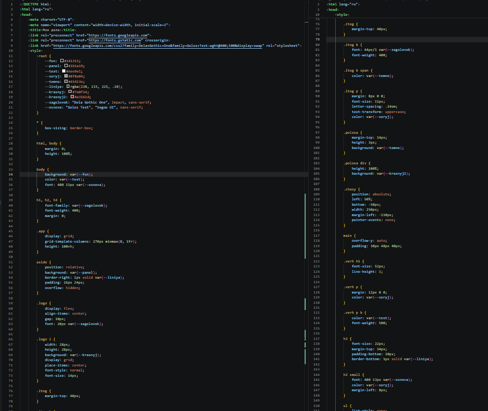

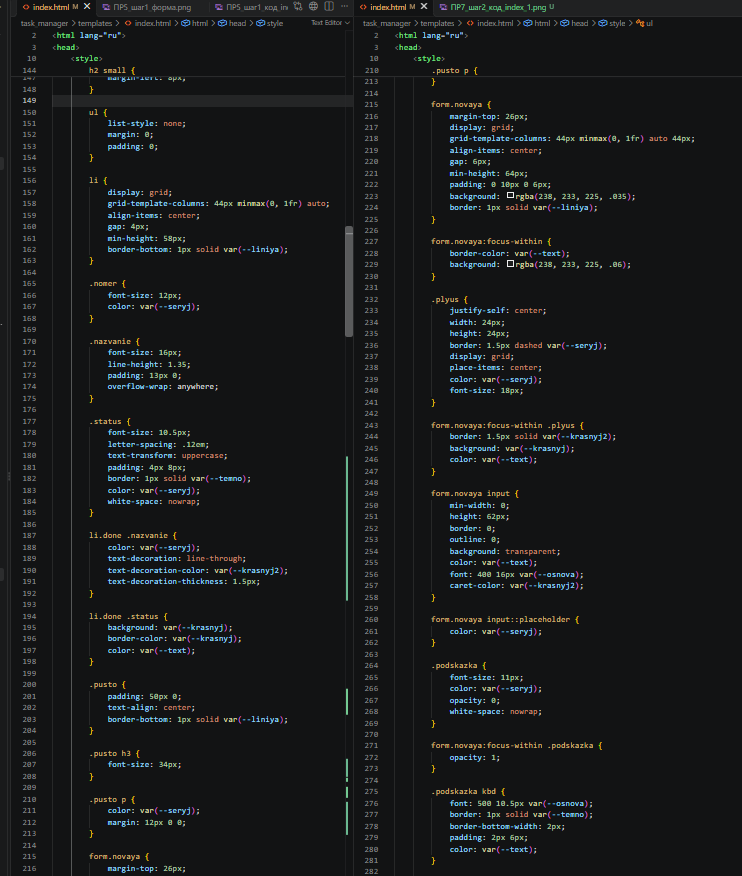

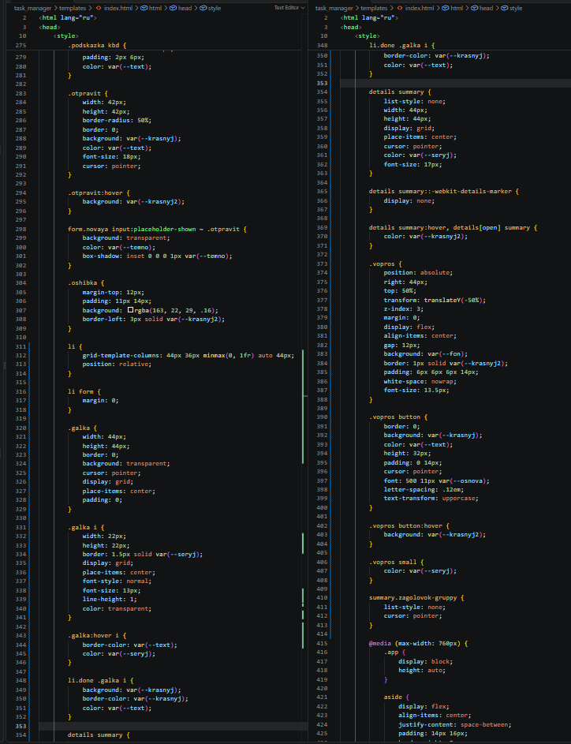

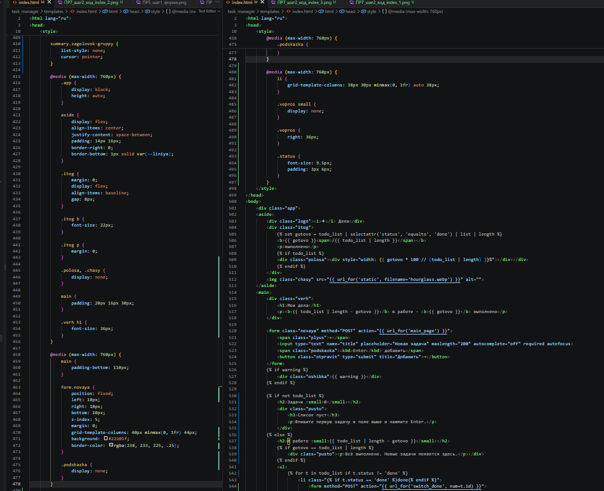

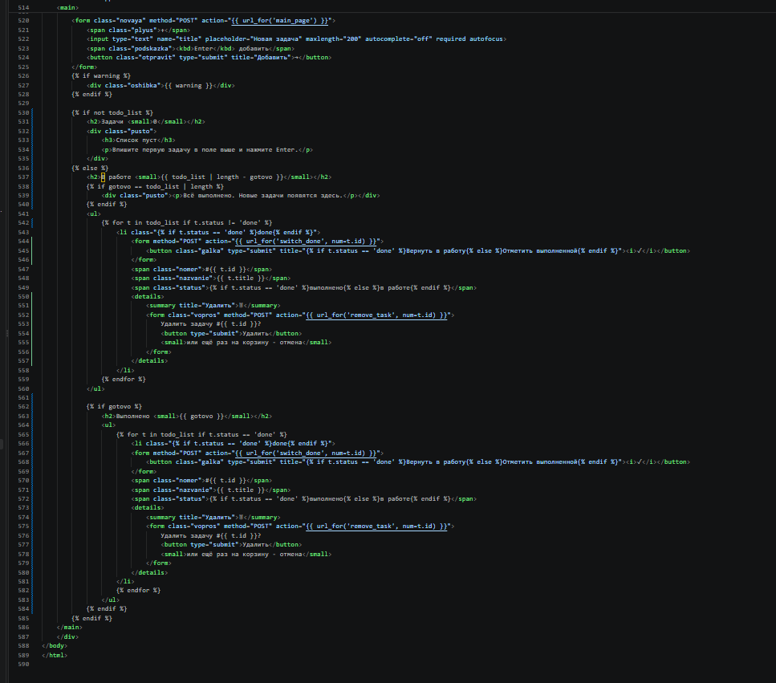

### Шаг 3. Полный новый app.py

*Код файла app.py*

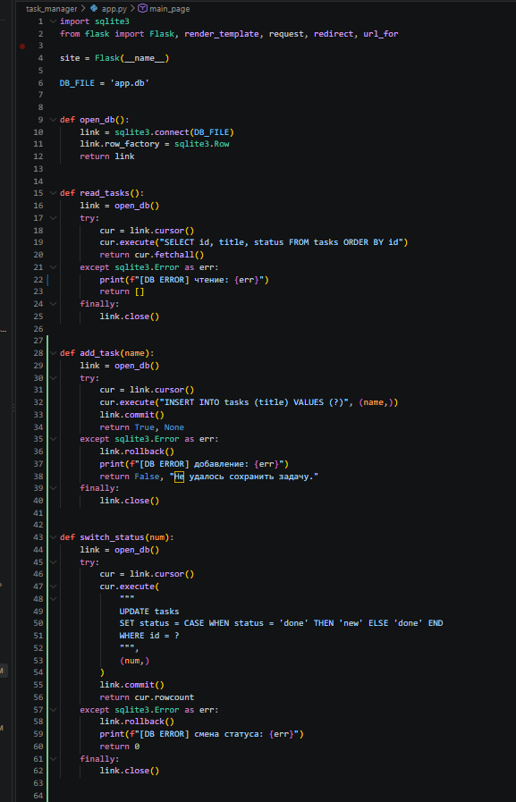

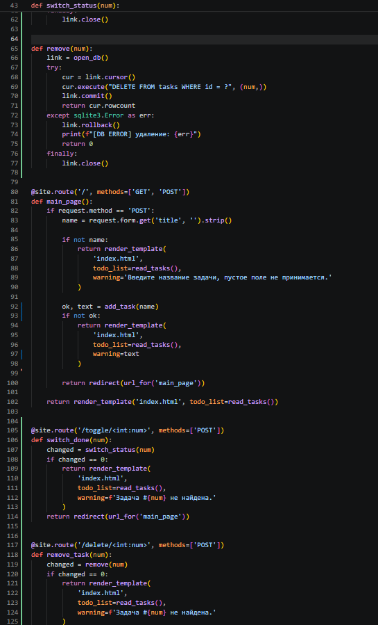

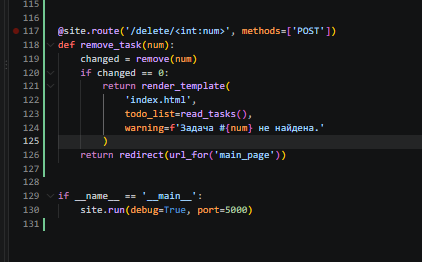

### Шаг 4. Запуск и базовый сценарий

*Список задач*

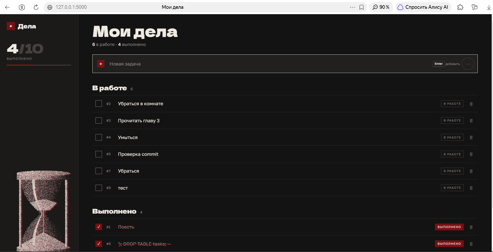

*Задача отмечена выполненной*

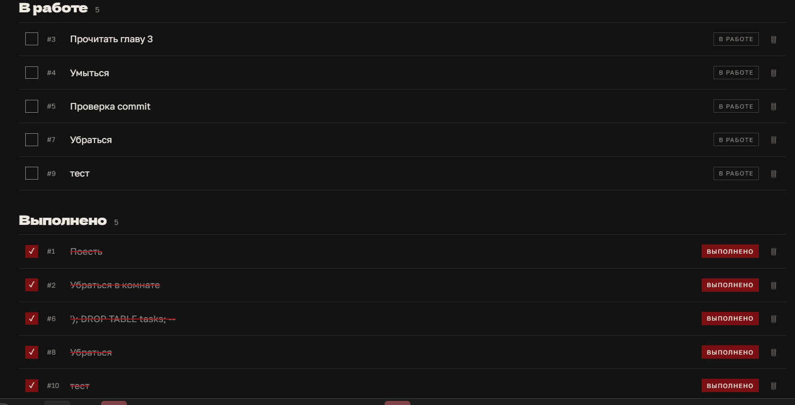

*Подтверждение удаления*

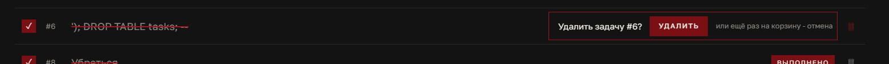

### Шаг 5. Проверка полноты CRUD

*Консольное приложение показывает те же задачи, что и сайт*

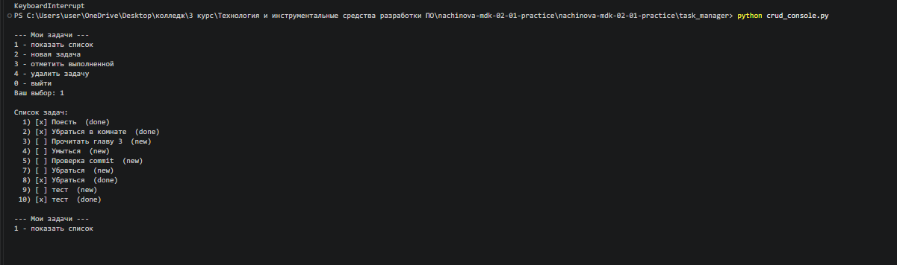

### Шаг 6. Проверка защиты от неверных запросов

*GET-запрос к /delete/1: ошибка 405*

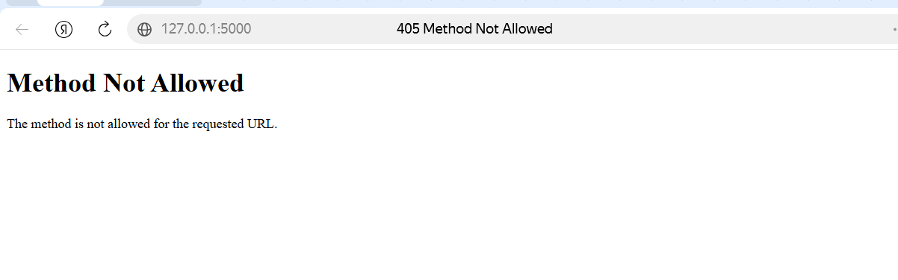

*Сообщение «Задача не найдена»*

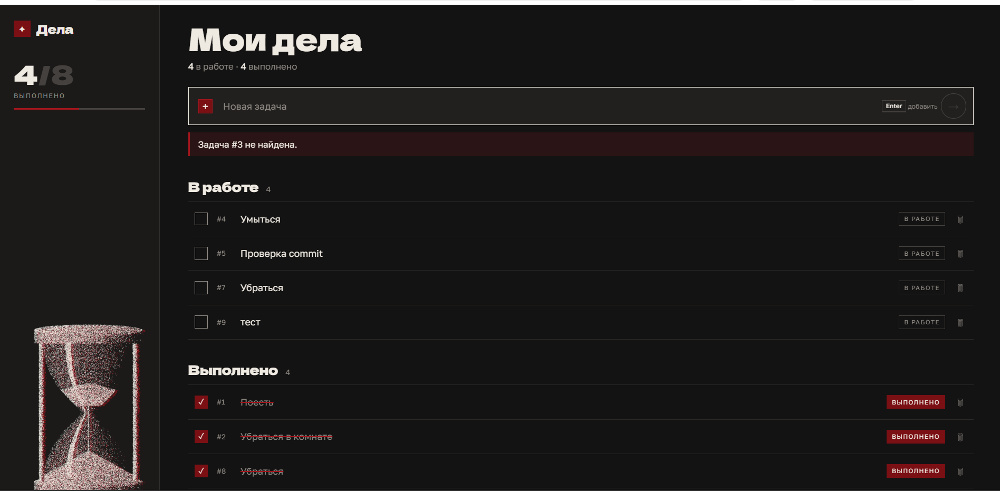

*Адрес /toggle/abc: ошибка 404*

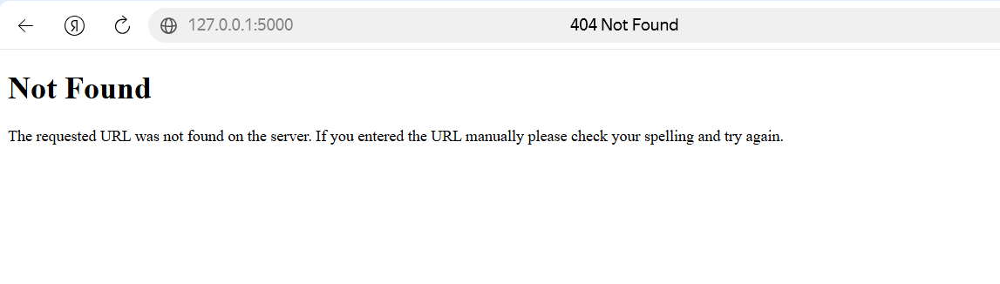

*Инъекция сохранена как текст*

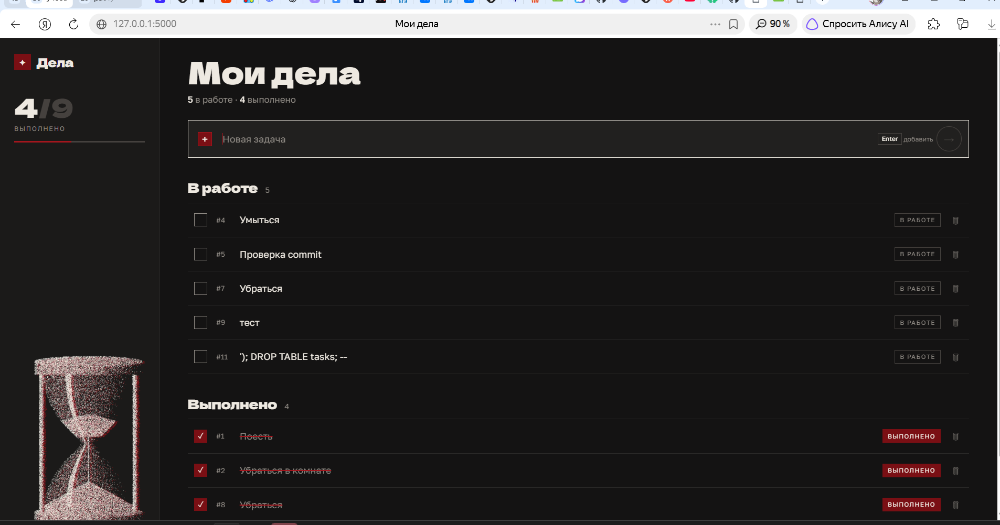

### Шаг 7. Эксперимент: отключаем rollback

*Ошибка при убранном rollback*

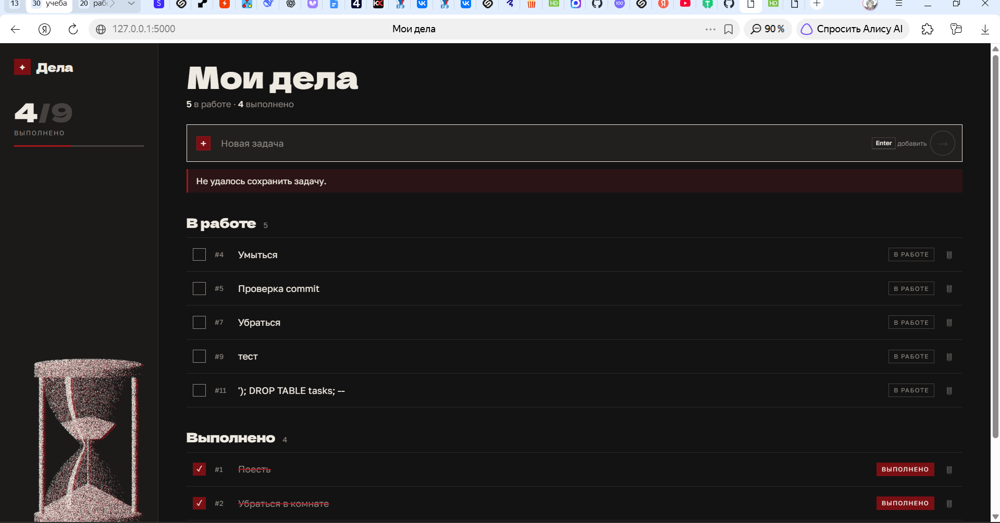

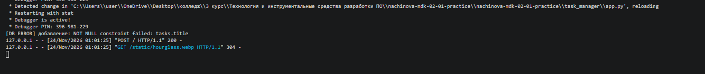

### Шаг 8. Проверка «живучести» после серии ошибок

*Форма с сообщением об ошибке после серии отправок пустого названия*

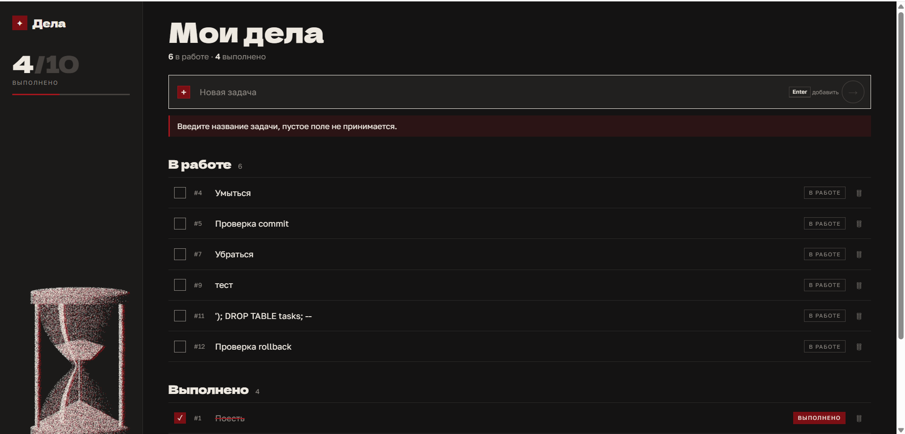

*Консольное приложение добавило задачу без database is locked*

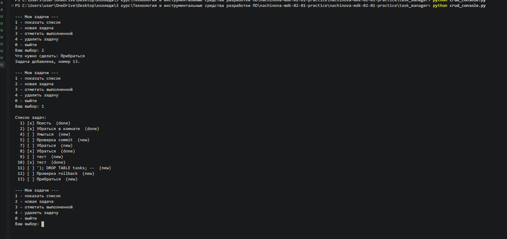

---

## Контрольные вопросы

### 1. Почему действия «переключить статус» и «удалить» отправляются через POST-форму, а не через <a href>?

Ссылка (<a href>) - это GET, а GET не должен менять данные (его может вызвать браузер при предзагрузке, поисковик, случайный переход). Изменения - только через POST.

### 2. Что делает конвертер <int:task_id> в маршруте и почему с ним не нужен isdigit()?

Преобразует часть адреса в целое число; /toggle/abc не совпадёт с маршрутом и даст 404, isdigit() не нужен.

### 3. Что означает rowcount = 0 после UPDATE или DELETE?

Ни одна строка не подошла: такого id нет.

### 4. Почему каждая функция работы с базой открывает своё соединение, а не получает его параметром?

Соединение короткоживущее и закрывается внутри функции, функции независимы, нет «висящих» соединений.

### 5. Где в toggle_task_status находится commit(), и почему без него статус не сохранится после перезапуска?

После UPDATE перед закрытием соединения; без него изменение не запишется в файл.

### 6. Что произойдёт, если открыть /delete/3 в адресной строке браузера (GET)?

Страница вернёт 405: маршрут принимает только POST.

### 7. Зачем в шаблоне onsubmit="return confirm(...)" и можно ли обойти эту защиту?

Защита от случайного нажатия; обойти можно (отключить JS, отправить POST вручную), поэтому это удобство, а не защита.

### 8. Почему return redirect(url_for('index')) стоит после try/finally, а не внутри try?

Если return redirect внутри try, finally всё равно выполнится, но по структуре кода понятнее завершать работу с БД и только потом отвечать пользователю.

---

## Вывод

Я собрала приложение «Список задач» с полным набором операций CRUD, защитой от повторной отправки форм, проверкой ввода и обработкой ошибок базы данных.
